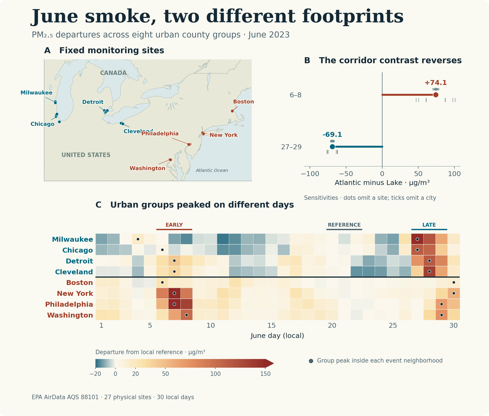

<h1 align="center">
  
</h1>

<p align="center">
  <a href="https://github.com/WUBING2023/PaperSpine/releases/download/v6.0.0-beta.2/paperspine-skill-6.0.0-beta.2.zip"><picture>
    <source media="(prefers-reduced-motion: reduce)" srcset="https://wubing2023.github.io/PaperSpine/v6/activity-still.svg">
    
  </picture></a>
</p>

<p align="center"><strong>Beginne mit einer Forschungsfrage, Daten oder einem Entwurf. Erhalte ein bearbeitbares Manuskript mit überprüfbarer Evidenz.</strong></p>

<p align="center">
  <a href="#install-with-ai"><strong>Schnelleinstieg</strong></a> · <a href="#quick-demo">Demo</a> · <a href="#research-cases">Forschungsbeispiele</a><br>
  <small><a href="https://wubing2023.github.io/PaperSpine/v6/de/">Website</a> · <a href="https://wubing2023.github.io/PaperSpine/v6/de/install.html">Installationsanleitung</a> · <a href="#ways-to-work">Ausgaben vergleichen</a> · <a href="https://wubing2023.github.io/PaperSpine/?lang=de">Community-Atlas</a></small>
</p>

<p align="center">
  <a href="https://github.com/WUBING2023/PaperSpine/releases/tag/v6.0.0-beta.2"></a>
  <a href="https://github.com/WUBING2023/PaperSpine/stargazers"></a>
  <a href="LICENSE"></a>
  <a href="https://github.com/WUBING2023/PaperSpine/actions/workflows/validate.yml"></a>
  <a href="https://wubing2023.github.io/PaperSpine/contributors/de.html"></a>
  <a href="https://github.com/WUBING2023/PaperSpine/issues?q=is%3Aissue+is%3Aclosed"></a>
  <a href="https://github.com/WUBING2023/PaperSpine/commits/main/"></a>
</p>

<p align="center">
  <sub>V6</sub>
  <a href="README.md"></a>
  <a href="README.zh-CN.md"></a>
  <a href="README.ja.md"></a>
  <a href="README.ko.md"></a>
  <a href="README.es.md"></a>
  <a href="README.fr.md"></a>
  <a href="README.de.md"></a>
  <a href="README.pt.md"></a>
  <a href="README.ru.md"></a>
</p>

<a id="quick-demo"></a>

## Ein Manuskript wie in der Forschung schreiben

<p align="center">
  <picture>
    <source media="(prefers-reduced-motion: reduce)" srcset="paperspine5/core/07_发布页/v6/readme/rounded/paperspine_codex_demo_v3_15s-still.webp">
    
  </picture>
</p>

<p align="center"><small>Followwriting · Abbildungsprüfung · Manuskriptvorschau · Überarbeitung</small></p>

<a id="workflow"></a>

## So funktioniert PaperSpine

Nutze Referenzartikel als Schreibvorbilder und stütze die Schlussfolgerungen mit Evidenz aus deiner eigenen Studie.

<p align="center">
  <picture>
    <source media="(prefers-reduced-motion: reduce)" srcset="paperspine5/core/07_发布页/v6/readme/rounded/paperspine-workflow-8s-zh-still.webp">
    
  </picture>
</p>

<p align="center"><small>Evidenz sammeln → Mit Referenzen schreiben → Bearbeitbare Abbildungen erstellen → Prüfen und liefern</small></p>

<a id="install-with-ai"></a>

## Mit deinem KI-Agenten installieren

Füge diese Anfrage beim Agenten ein, den du für deine Forschung verwendest.

```text
Installiere PaperSpine in dieser Umgebung. Lies zuerst die offizielle Anleitung.
https://wubing2023.github.io/PaperSpine/v6/llms.txt

Wähle die passende Ausgabe für meine Aufgabe und Umgebung. Prüfe das ZIP mit SHA-256. Bestätige nach der Installation die Version und erkläre, wie ich den Skill aufrufe.
```

[Installationsanleitung für den Agenten](https://wubing2023.github.io/PaperSpine/v6/llms.txt) · [Release-Manifest (JSON)](https://wubing2023.github.io/PaperSpine/v6/channel.json)

<a id="ways-to-work"></a>

## Drei Arbeitsweisen

<a id="start-with-skill"></a>

### Schnelleinstieg · Skill für den gesamten Ablauf

Rufe `$paper-spine` im Agenten-Chat mit einer Frage, Daten oder einem Entwurf auf. Du erhältst Forschungsnotizen, Analysen, Abbildungen und ein bearbeitbares Manuskript im vereinbarten Umfang.

[**ZIP herunterladen**](https://github.com/WUBING2023/PaperSpine/releases/download/v6.0.0-beta.2/paperspine-skill-6.0.0-beta.2.zip) · 

### Gezielte Forschung · Skill-Paket

Verwende `$paper-spine` für den gesamten Ablauf oder rufe eine Phase direkt auf. Mit `$paper-spine-followwriting` kannst du zum Beispiel einen Abschnitt anhand eigener Ergebnisse und Referenzartikel überarbeiten.

[**ZIP herunterladen**](https://github.com/WUBING2023/PaperSpine/releases/download/v6.0.0-beta.2/paperspine-skills-pack-6.0.0-beta.2.zip) · 

### Begutachtungsumgebung · Web-Plug-in

Ergänze die optionale lokale Arbeitsumgebung, um Abbildungen, Entwürfe und Überarbeitungshinweise im Browser zu bearbeiten. Sie enthält das Skill-Paket und startet mit `$paper-spine-web:paper-spine-web` in Codex unter Windows x64.

[**ZIP herunterladen**](https://github.com/WUBING2023/PaperSpine/releases/download/v6.0.0-beta.2/paperspine-web-plugin-6.0.0-beta.2-windows-x64.zip) · 

<details>
<summary><strong>Fünf Phasen-Skills mit Beispielanfragen</strong></summary>

| Skill | Beispielanfrage |
| --- | --- |
| `$paper-spine-study` | Entwirf einen gepaarten Test mit diesem Datensatz und speichere die Ergebnisse je Aufteilung. |
| `$paper-spine-followwriting` | Überarbeite die Argumentation im Ergebnisteil anhand dieser Referenzartikel. Behalte meine Schätzwerte und den Geltungsbereich der Aussagen bei. |
| `$paper-spine-figures` | Erstelle aus diesen Analyseergebnissen eine Vektorabbildung und füge den Abbildungscode bei. |
| `$paper-spine-review` | Prüfe, welche Aussagen durch Quellen und Abbildungen gedeckt sind, und überarbeite die schwach belegten. |
| `$paper-spine-deliver` | Exportiere das bearbeitbare Manuskript, eine Lesefassung und die Begleitmaterialien. |

</details>

<a id="installation"></a>

## Installation und Aktualisierung

Prüfe das ZIP anhand der Prüfsummenliste. Entpacke es und starte den Manager aus dem extrahierten Ordner mit dem Originalpfad des ZIP und dem vollständigen SHA-256. Öffne dann einen neuen Host-Chat.

```text
python -B edition_manager.py install "<original ZIP path>" --sha256 <SHA256>
```

Der Manager benötigt Python 3.12 oder neuer. Das Web-Archiv enthält Python für Windows und setzt die Codex-CLI voraus. Verwaltete Installationen unterstützen automatische Update-Prüfungen, manuelle Aktualisierungen, Rollback und Deinstallation. Entwürfe und lokale Aufgaben bleiben erhalten.

[Installieren, aktualisieren oder deinstallieren](https://wubing2023.github.io/PaperSpine/v6/de/install.html) · [SHA-256-Prüfsummen](https://github.com/WUBING2023/PaperSpine/releases/download/v6.0.0-beta.2/checksums.sha256) · [V6-Release](https://github.com/WUBING2023/PaperSpine/releases/tag/v6.0.0-beta.2)

## Wie PaperSpine Evidenz ins Manuskript überführt

- **Lege den Umfang anhand des Ausgangsmaterials fest.** Eine Forschungsfrage kann öffentliche Daten oder eine neue Analyse erfordern. Vorhandene Ergebnisse führen direkt zur gewünschten Abbildung, Argumentation oder Prüfung. Der Agent übernimmt Dateien und Entscheidungen zwischen den Phasen.
- **Verfolge Textentscheidungen und wissenschaftliche Belege getrennt.** Followwriting verweist auf die Referenzpassagen für Struktur und Formulierung. Die Aussagen stützen sich auf die eigene Evidenz. Halte Analyse, Abbildungsquellen und unterstützende Zitate überprüfbar.
- **Verankere die Begutachtung im selben Manuskript.** Speichere ausgewählte Abbildung und Kritik mit dem bearbeitbaren Manuskript. Bei der Überarbeitung kannst du die Belege neu prüfen, Text und betroffene Abbildungen aktualisieren und Änderungen dokumentieren.

Die LIGO-Studie zeigt das Vorgehen. Verfolge die berichtete Ankunftsreihenfolge vom Artikel zu den ausgerichteten Dehnungssignalen und neun Vorverarbeitungsprüfungen. [LIGO-Evidenz und Quelldateien](https://wubing2023.github.io/PaperSpine/v6/de/#gravitational-waves)

<a id="research-cases"></a>

## Intensivierung atlantischer Wirbelstürme bei vergleichbaren Ausgangsbedingungen

Mit dem eigenständigen Skill verglich PaperSpine 42 Saisons der NOAA-Best-Track-Daten. In 6.017 vergleichbaren 24-Stunden-Fenstern betrug der Unterschied bei 30 Knoten +0,81 Prozentpunkte (95-%-Saison-Bootstrap-Intervall −1,69 bis +3,43). Der Punktschätzer bei 25 Knoten wechselte das Vorzeichen. Sechs Panels zeigen 484 beobachtete 24-Stunden-Bahnen, disjunkte Zuwachsklassen und den Kontrast mit Unsicherheit für neun Schwellen.

<a href="https://wubing2023.github.io/PaperSpine/v6/de/#showcase"></a>

[Artikel lesen](https://wubing2023.github.io/PaperSpine/v6/science/research/atlantic-ri/paper.pdf) · [Hauptabbildung als SVG](paperspine5/core/07_发布页/v6/science/research/atlantic-ri/figure.svg) · [Sensitivität als SVG](paperspine5/core/07_发布页/v6/science/research/atlantic-ri/checks.svg) · [Bearbeitbares Manuskript und Analysecode](https://wubing2023.github.io/PaperSpine/v6/science/research/atlantic-ri/source.zip)

Wechsle zwischen Studien sowie zwischen Titelseite, Ergebnissen, Haupt- und Sensitivitätsabbildung. [Studiengalerie öffnen](https://wubing2023.github.io/PaperSpine/v6/de/?v=research-gallery#showcase)

<a id="edition-field-test"></a>

## Drei Studien, drei Modi

GPT‑6.1 Sol nutzte alle drei Ausgaben von PaperSpine für jede Studie. Die [neun dokumentierten Durchläufe](paperspine5/core/07_发布页/v6/science/research/README.md#how-the-runs-were-conducted) enthalten Manuskripte, öffentliche Daten, Originalabbildungen, reproduzierbaren Code und Überarbeitungsprotokolle.

[Zwischen Manuskriptseiten, Abbildungen und Sensitivitätsprüfungen wechseln](https://wubing2023.github.io/PaperSpine/v6/de/#showcase)

### Das Timing zweier Verschmelzungen Schwarzer Löcher im Millisekundenbereich

Bei zwei öffentlichen LIGO-Ereignissen empfing Hanford das Signal 7,36 bzw. 7,75 ms nach Livingston. Bei allen neun Vorverarbeitungsvarianten blieb das Vorzeichen beider Verzögerungen gleich.

<a href="paperspine5/core/07_发布页/v6/science/research/gravitational-waves/figure.svg"></a>

[Artikel lesen](https://wubing2023.github.io/PaperSpine/v6/science/research/gravitational-waves/paper.pdf) · [Hochauflösende Vektorabbildung](paperspine5/core/07_发布页/v6/science/research/gravitational-waves/figure.svg) · [Manuskriptquellen und Code](https://wubing2023.github.io/PaperSpine/v6/science/research/gravitational-waves/source.zip) · [Daten](https://doi.org/10.7935/82H3-HH23)

### Die Abnahme der Nachbebenrate hängt vom Katalog ab

Bei gemeldeter Magnitude M ≥ 1,5 und 1–72 Stunden nach dem Mw-7,1-Ereignis lagen die angepassten Exponenten bei 0,55 in ComCat und 0,48 im relokalisierten Shelly-Katalog.

<a href="paperspine5/core/07_发布页/v6/science/research/ridgecrest/figure.svg"></a>

[Artikel lesen](https://wubing2023.github.io/PaperSpine/v6/science/research/ridgecrest/paper.pdf) · [Hochauflösende Vektorabbildung](paperspine5/core/07_发布页/v6/science/research/ridgecrest/figure.svg) · [Manuskriptquellen und Code](https://wubing2023.github.io/PaperSpine/v6/science/research/ridgecrest/source.zip) · [Daten](https://doi.org/10.5066/P9JN6H0N)

### Zwei regionale Rauchmuster im Juni

Gegenüber dem stationsspezifischen Median vom 20.–22. Juni kehrte sich der Atlantik–Große-Seen-Unterschied der PM₂.₅-Abweichungen von +74,1 µg/m³ am 6.–8. Juni auf −69,1 µg/m³ am 27.–29. Juni um.

<a href="paperspine5/core/07_发布页/v6/science/research/smoke/figure.svg"></a>

[Artikel lesen](https://wubing2023.github.io/PaperSpine/v6/science/research/smoke/paper.pdf) · [Hochauflösende Vektorabbildung](paperspine5/core/07_发布页/v6/science/research/smoke/figure.svg) · [Manuskriptquellen und Code](https://wubing2023.github.io/PaperSpine/v6/science/research/smoke/source.zip) · [Daten](https://aqs.epa.gov/aqsweb/airdata/download_files.html)

[Notizen zu den drei Modi](paperspine5/core/07_发布页/v6/science/research/README.md) · [Funktionstest einer früheren Ausgabe](paperspine5/core/07_发布页/v6/science/edition-field-test.md)

<a id="paper-example"></a>
<a id="feature-demos"></a>

## Funktionsdemos

<table><tr>
  <td width="50%"><a href="paperspine5/core/07_发布页/v6/science/followwriting-hd.gif"><picture>
    <source media="(prefers-reduced-motion: reduce)" srcset="paperspine5/core/07_发布页/v6/readme/rounded/followwriting-hd-still.webp">
    
  </picture></a><br><strong>Followwriting</strong></td>
  <td width="50%"><a href="paperspine5/core/07_发布页/v6/science/figures-hd.gif"><picture>
    <source media="(prefers-reduced-motion: reduce)" srcset="paperspine5/core/07_发布页/v6/readme/rounded/figures-hd-still.webp">
    
  </picture></a><br><strong>Abbildungen prüfen</strong></td>
</tr><tr>
  <td width="50%"><a href="paperspine5/core/07_发布页/v6/science/workbench-hd.gif"><picture>
    <source media="(prefers-reduced-motion: reduce)" srcset="paperspine5/core/07_发布页/v6/readme/rounded/workbench-hd-still.webp">
    
  </picture></a><br><strong>Manuskriptvorschau</strong></td>
  <td width="50%"><a href="paperspine5/core/07_发布页/v6/science/revision-hd.gif"><picture>
    <source media="(prefers-reduced-motion: reduce)" srcset="paperspine5/core/07_发布页/v6/readme/rounded/revision-hd-still.webp">
    
  </picture></a><br><strong>Prüfen und überarbeiten</strong></td>
</tr></table>

Followwriting zeigt, wie die Struktur eines Referenzartikels beim Schreiben aus eigenen Ergebnissen hilft. Die übrigen Clips stammen aus der veröffentlichten Windows-Arbeitsumgebung. [Von der Rückmeldung zur Überarbeitung](https://wubing2023.github.io/PaperSpine/v6/de/#revision) · [Aufnahmen der Arbeitsumgebung in voller Größe](https://wubing2023.github.io/PaperSpine/v6/de/#examples)

## Entwicklung und Community

<a href="https://wubing2023.github.io/PaperSpine/?lang=de"></a>

[Mitwirkende der einzelnen V6-Updates ansehen](https://wubing2023.github.io/PaperSpine/contributors/de.html#v6-contributions) · [Sternatlas erkunden](https://wubing2023.github.io/PaperSpine/?lang=de) · [Atlasdaten (JSON)](https://wubing2023.github.io/PaperSpine/api/v1/atlas.json)

[Offizielle Website](https://wubing2023.github.io/PaperSpine/v6/de/) · [V6-Quellcode](paperspine5/core/01_PaperSpine4/src/skill-editions/) · [Installationsmanager](paperspine5/core/06_插件化/release/edition_manager.py) · [Website-Quellcode](paperspine5/core/07_发布页/v6/) · [Problem melden](https://github.com/WUBING2023/PaperSpine/issues) · <a id="press-kit"></a>[Projektmaterial](https://wubing2023.github.io/PaperSpine/v6/science/paperspine-v6-press-kit.zip)

<details>
<summary>V5-Dokumentation und Quellcode-Index</summary>

- Methoden und Arbeitsmaterialien · [writing_rationale_matrix](src/skill/references/rewrite.md) · [citation_support_bank](src/skill/references/citation-support-bank.md) · [translation_package](src/skill/references/translation-package.md)
- Export- und Prüfwerkzeuge · [artifact_check.py](src/scripts/artifact_check.py) · [reference_inventory.py](src/scripts/reference_inventory.py) · [citation_bank_check.py](src/scripts/citation_bank_check.py) · [latex_guard.py](src/scripts/latex_guard.py) · [word_guard.py](src/scripts/word_guard.py)
- Ältere Host-Varianten · [Codex](dist/codex/skills/paper-spine/) · [Claude](dist/claude/skills/paper-spine/) · [OpenClaw](dist/openclaw/skills/paper-spine/) · [Claude-Befehl](dist/claude/commands/paperspine.md)
- V5-Installationsprogramme · [install.ps1](install.ps1) · [install.sh](install.sh)

[V5-Archiv](https://wubing2023.github.io/PaperSpine/v5/en/?legacy=1)

</details>

## Lizenz

[MIT](LICENSE) · [Instrument Serif](paperspine5/core/07_发布页/v6/fonts/instrument-OFL.txt) · [Noto Serif SC](paperspine5/core/07_发布页/v6/fonts/notoserifsc-OFL.txt)
