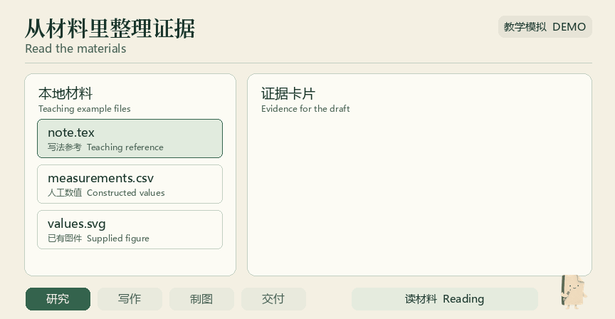
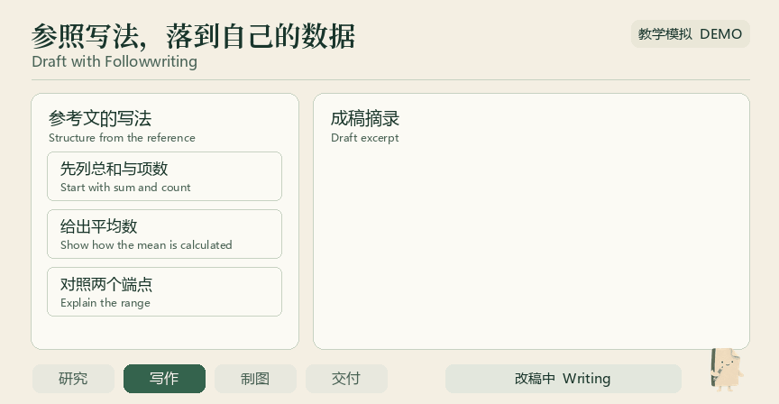
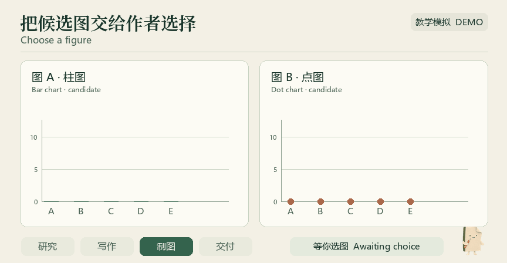
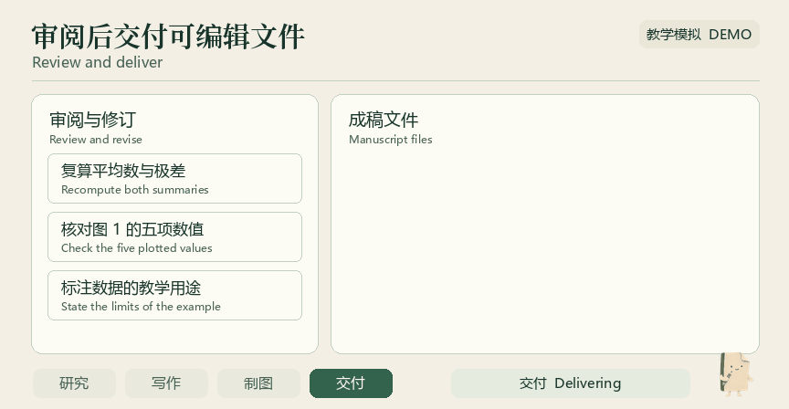
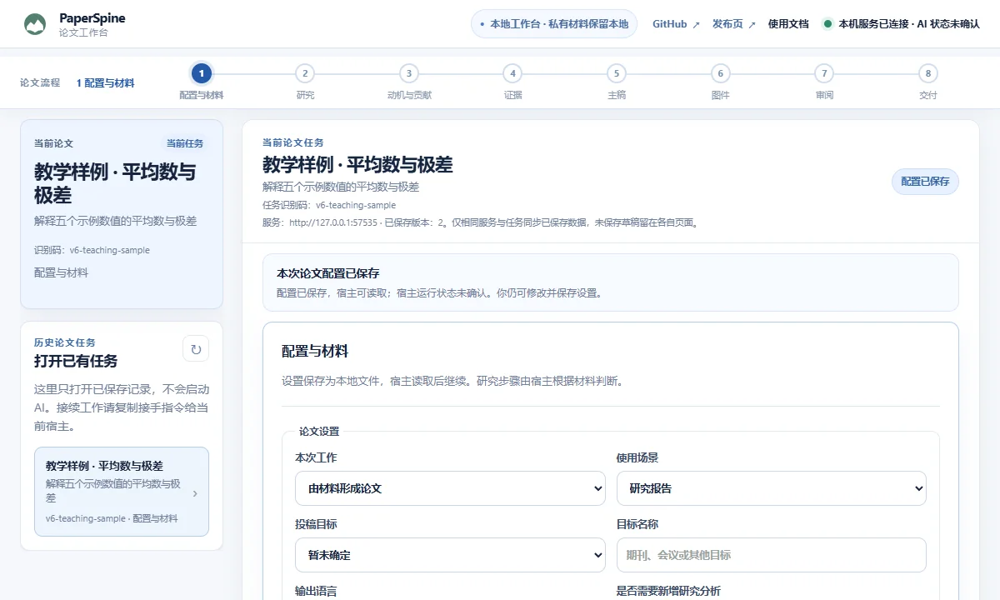

<p align="center">
  <b>English</b> · <a href="README.md">简体中文</a>
</p>

<p align="center">
  <a href="https://wubing2023.github.io/PaperSpine/v6/en/"></a>
</p>

<p align="center">Research-paper Skills for your agent. Start with a question, existing results, or a draft, and work through the literature, writing, figures, and review in one conversation.</p>

<p align="center">
  <b><a href="https://wubing2023.github.io/PaperSpine/v6/en/#download">Website and downloads</a></b> · <a href="https://github.com/WUBING2023/PaperSpine/releases/tag/v6.0.0-beta.2">GitHub Release</a> · <a href="INSTALL-V6.en.md">Install and uninstall</a> · <a href="#paper-example">Paper example</a>
</p>

## Download PaperSpine V6

The current public beta is `6.0.0-beta.2`. Choose one edition.

| Edition | Use it when | Requirements | Download |
| --- | --- | --- | --- |
| **Full Workflow Skill** | You want one entry point for the whole paper | Skill-compatible host | [Download ZIP](https://github.com/WUBING2023/PaperSpine/releases/download/v6.0.0-beta.2/paperspine-skill-6.0.0-beta.2.zip) |
| **Skills Pack** | You frequently reuse individual steps such as writing, figures, or review | Skill-compatible host | [Download ZIP](https://github.com/WUBING2023/PaperSpine/releases/download/v6.0.0-beta.2/paperspine-skills-pack-6.0.0-beta.2.zip) |
| **Web Plugin** | You want a local workbench for settings, figures, previews, and feedback | Windows x64 · Codex | [Download ZIP](https://github.com/WUBING2023/PaperSpine/releases/download/v6.0.0-beta.2/paperspine-web-plugin-6.0.0-beta.2-windows-x64.zip) |

Each archive and the SHA-256 checksums are available in the same release. The install guide covers managed installation and manual copying. [Read the install guide](INSTALL-V6.en.md) · [Download checksums](https://github.com/WUBING2023/PaperSpine/releases/download/v6.0.0-beta.2/checksums.sha256)

## Quick start

1. Download an edition and the checksums file. Extract the ZIP.
2. Run the install command from the extracted directory. Replace `<ZIP path>` and `<SHA256>` with the original archive path and its checksum.
3. Open a new conversation and give `$paper-spine` a question, a results folder, or a draft.

```text
python -B edition_manager.py install "<ZIP path>" --sha256 <SHA256>
```

The manager requires Python 3.12 or later. The Windows Web package bundles Python and requires the Codex CLI.

A first message could look like this

```text
$paper-spine Turn ./results and ./draft.md into a paper. First identify the main claims and gaps in their evidence. Use the existing results and figures.
```

With the Skills Pack, you can also pick up at the stage you need.

| Skill | Use it to |
| --- | --- |
| `$paper-spine-study` | **Research**. Organize the research question, materials, and evidence that can be checked. |
| `$paper-spine-followwriting` | **Followwriting**. Learn argument and paragraph structure from reference papers and revise the current draft. |
| `$paper-spine-figures` | **Figures**. Match figures to claims and compare candidates. |
| `$paper-spine-review` | **Review**. Check evidence, figures, and citations, and identify what to revise. |
| `$paper-spine-deliver` | **Delivery**. Prepare the requested editable files and reading formats. |

After installing the Web package, call `$paper-spine-web:paper-spine-web` in Codex to open the local workbench.

<a id="paper-example"></a>

## From materials to manuscript

Four animations simulate the workflow using a single teaching example with constructed values. The manuscript preview and workbench screenshot come from a local trial.

<p align="center"></p>

**Meet Yeye.** A folded sheet with a pencil, and PaperSpine’s mascot for the demos. Watch for it as the agent reads, writes, waits for a figure choice, and delivers a draft.

### Read the materials and extract the evidence

Identify five values in the supplied material and calculate their mean and range.

<picture>
  <source media="(prefers-reduced-motion: reduce)" srcset="paperspine5/core/07_发布页/v6/readme/research-still.webp">
  
</picture>

### Revise a passage with Followwriting

The reference presents the total and count before explaining the gap between endpoints. The draft uses the values from the example.

<picture>
  <source media="(prefers-reduced-motion: reduce)" srcset="paperspine5/core/07_发布页/v6/readme/followwriting-still.webp">
  
</picture>

### Compare two figures and ask the author

Compare a bar chart and dot plot of the same values. In the example the author chooses the bar chart.

<picture>
  <source media="(prefers-reduced-motion: reduce)" srcset="paperspine5/core/07_发布页/v6/readme/figure-choice-still.webp">
  
</picture>

### Review, revise, and deliver

Recompute both summaries, verify the figure, and state what the teaching example covers. Deliver the manuscript, PDF, and editable figure source.

<picture>
  <source media="(prefers-reduced-motion: reduce)" srcset="paperspine5/core/07_发布页/v6/readme/review-delivery-still.webp">
  
</picture>

[Open the full manuscript preview](paperspine5/core/07_发布页/v6/draft-example.webp)

<details>
<summary>Optional local workbench</summary>

Save settings, choose figures, preview the draft, and leave feedback for the same paper task.



</details>

## Update and uninstall

Managed installations update the chosen edition together. The Skill periodically checks the V6 channel on invocation. The manager validates the next package and keeps a version for rollback. Uninstall preserves drafts, source materials, and local workbench tasks.

| Manager command | What it does |
| --- | --- |
| `check` / `update` | Check for or apply updates. |
| `auto-update off` / `auto-update on` | Turn automatic checks off or on. |
| `rollback` | Restore the retained previous version. |
| `uninstall` | Remove this managed installation. |

[All commands and options](INSTALL-V6.en.md)

## FAQ

<details>
<summary>Do I need a browser?</summary>

Both Skill editions run in your agent’s chat. The Web package offers an optional workbench for Codex on Windows x64.

</details>

<details>
<summary>Can I start with an existing draft or results?</summary>

Yes. Give the agent your results, figure sources, draft, and writing requirements. You can ask it to edit using the existing experiments.

</details>

<details>
<summary>What happens to my V5 papers?</summary>

You can keep using V5 through its archive. The V6 workbench defaults to a separate task directory. Automatic V5 profile migration is unverified. You can use your V5 manuscript files as input to a V6 Skill.

</details>

<details>
<summary>Where are the materials processed?</summary>

The workbench stores task data locally. What reaches a model depends on the host and the configured provider. For sensitive material, check the host’s permissions, data settings, and your institution’s requirements. Researchers verify scientific claims, citations, and author information.

</details>

## Development and contributing

The stage Skills, writing methods, release managers, and website are in this repository. Start with the existing GitHub Actions workflow to build V6 distributions.

- [Stage Skill sources](paperspine5/core/01_PaperSpine4/src/skill-editions/)
- [Research and writing methods](paperspine5/core/01_PaperSpine4/src/skill/references/)
- [Install and update manager](paperspine5/core/06_插件化/release/edition_manager.py)
- [V6 website and builder](paperspine5/core/07_发布页/v6/)
- [Release build workflow](.github/workflows/build-v6-release.yml)

To report a problem, open a GitHub issue with redacted steps, your edition, and the version. The public community atlas uses information GitHub Stargazers share on their profiles. [Report an issue](https://github.com/WUBING2023/PaperSpine/issues) · [Community atlas](https://wubing2023.github.io/PaperSpine/v5/community/en.html)

[V5 website and documentation archive](https://wubing2023.github.io/PaperSpine/v5/en/?legacy=1)

<details>
<summary>V5 documentation in other languages</summary>

[日本語](README.ja.md) · [한국어](README.ko.md) · [Español](README.es.md) · [Français](README.fr.md) · [Deutsch](README.de.md) · [Русский](README.ru.md) · [Português](README.pt.md)

</details>

## License

PaperSpine code is released under MIT. Font licenses are included with the website sources. [MIT](LICENSE) · [Instrument Serif](paperspine5/core/07_发布页/v6/fonts/instrument-OFL.txt) · [Noto Serif SC](paperspine5/core/07_发布页/v6/fonts/notoserifsc-OFL.txt)
