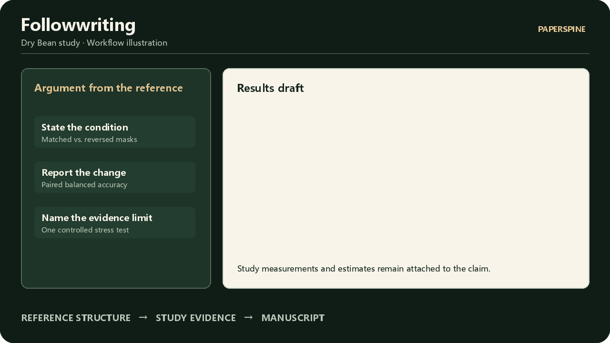
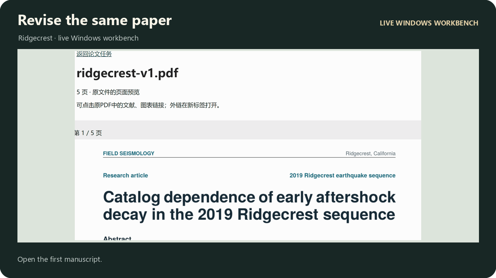

<h1 align="center">
  
</h1>

<p align="center">
  <a href="https://github.com/WUBING2023/PaperSpine/releases/download/v6.0.0-beta.2/paperspine-skill-6.0.0-beta.2.zip"><picture>
    <source media="(prefers-reduced-motion: reduce)" srcset="https://wubing2023.github.io/PaperSpine/v6/activity-still.svg">
    
  </picture></a>
</p>

<p align="center"><strong>Empieza con una pregunta de investigación, datos o un borrador. Obtén un manuscrito editable con evidencia que puedas comprobar.</strong></p>

<p align="center">
  <a href="#install-with-ai"><strong>Inicio rápido</strong></a> · <a href="#quick-demo">Demostración</a> · <a href="#research-cases">Casos de investigación</a><br>
  <small><a href="https://wubing2023.github.io/PaperSpine/v6/es/">Sitio web</a> · <a href="https://wubing2023.github.io/PaperSpine/v6/es/install.html">Guía de instalación</a> · <a href="#ways-to-work">Comparar ediciones</a> · <a href="https://wubing2023.github.io/PaperSpine/?lang=es">Atlas de la comunidad</a></small>
</p>

<p align="center">
  <a href="https://github.com/WUBING2023/PaperSpine/releases/tag/v6.0.0-beta.2"></a>
  <a href="https://github.com/WUBING2023/PaperSpine/stargazers"></a>
  <a href="LICENSE"></a>
  <a href="https://github.com/WUBING2023/PaperSpine/actions/workflows/validate.yml"></a>
  <a href="https://wubing2023.github.io/PaperSpine/contributors/es.html"></a>
  <a href="https://github.com/WUBING2023/PaperSpine/issues?q=is%3Aissue+is%3Aclosed"></a>
  <a href="https://github.com/WUBING2023/PaperSpine/commits/main/"></a>
</p>

<p align="center">
  <sub>V6</sub>
  <a href="README.md"></a>
  <a href="README.zh-CN.md"></a>
  <a href="README.ja.md"></a>
  <a href="README.ko.md"></a>
  <a href="README.es.md"></a>
  <a href="README.fr.md"></a>
  <a href="README.de.md"></a>
  <a href="README.pt.md"></a>
  <a href="README.ru.md"></a>
</p>

<a id="quick-demo"></a>

## Escribir un artículo como investigador

<p align="center">
  <picture>
    <source media="(prefers-reduced-motion: reduce)" srcset="paperspine5/core/07_发布页/v6/readme/rounded/paperspine_codex_demo_v3_15s-still.webp">
    
  </picture>
</p>

<p align="center"><small>Followwriting · Revisión de figuras · Vista previa del manuscrito · Correcciones</small></p>

<a id="workflow"></a>

## Cómo funciona PaperSpine

Usa artículos de referencia como modelos de redacción y apoya las conclusiones con evidencia de tu propio estudio.

<p align="center">
  <picture>
    <source media="(prefers-reduced-motion: reduce)" srcset="paperspine5/core/07_发布页/v6/readme/rounded/paperspine-workflow-8s-zh-still.webp">
    
  </picture>
</p>

<p align="center"><small>Reunir evidencia → Redactar a partir de referencias → Crear figuras editables → Revisar y entregar</small></p>

<a id="install-with-ai"></a>

## Instalar con tu IA

Pega esta solicitud en el agente que usas para investigar.

```text
Instala PaperSpine en este entorno. Lee primero la guía oficial.
https://wubing2023.github.io/PaperSpine/v6/llms.txt

Elige la edición adecuada para mi tarea y mi entorno. Verifica el ZIP con SHA-256. Tras instalarla, confirma la versión e indica cómo invocar el Skill.
```

[Guía de instalación para el agente](https://wubing2023.github.io/PaperSpine/v6/llms.txt) · [Manifiesto de la versión (JSON)](https://wubing2023.github.io/PaperSpine/v6/channel.json)

<a id="ways-to-work"></a>

## Tres formas de trabajar

<a id="start-with-skill"></a>

### Inicio rápido · Skill de flujo completo

Ejecuta `$paper-spine` en el chat con un agente y proporciónale una pregunta, datos o un borrador. Recibe notas, análisis, figuras y un manuscrito editable dentro del alcance acordado.

[**Descargar ZIP**](https://github.com/WUBING2023/PaperSpine/releases/download/v6.0.0-beta.2/paperspine-skill-6.0.0-beta.2.zip) · 

### Investigación especializada · Paquete de Skills

Usa `$paper-spine` para todo el proceso o invoca una etapa directamente. Por ejemplo, `$paper-spine-followwriting` ayuda a revisar una sección con tus propios resultados y artículos de referencia.

[**Descargar ZIP**](https://github.com/WUBING2023/PaperSpine/releases/download/v6.0.0-beta.2/paperspine-skills-pack-6.0.0-beta.2.zip) · 

### Espacio de revisión · Complemento web

Añade el espacio de trabajo local para comprobar figuras, previsualizar borradores y enviar notas de revisión desde el navegador. Incluye el paquete de Skills y se inicia con `$paper-spine-web:paper-spine-web` en Codex para Windows x64.

[**Descargar ZIP**](https://github.com/WUBING2023/PaperSpine/releases/download/v6.0.0-beta.2/paperspine-web-plugin-6.0.0-beta.2-windows-x64.zip) · 

<details>
<summary><strong>Cinco Skills por etapas con ejemplos</strong></summary>

| Skill | Qué pedir |
| --- | --- |
| `$paper-spine-study` | Diseña una prueba pareada con este conjunto de datos y guarda los resultados por partición. |
| `$paper-spine-followwriting` | Revisa el argumento de la sección de resultados con estos artículos de referencia. Mantén mis estimaciones y el alcance de las afirmaciones. |
| `$paper-spine-figures` | Crea una figura vectorial con estos resultados e incluye el código que la produjo. |
| `$paper-spine-review` | Comprueba qué afirmaciones respaldan las fuentes y figuras, y revisa las que tengan menor respaldo. |
| `$paper-spine-deliver` | Exporta el manuscrito editable, una copia de lectura y los materiales de apoyo. |

</details>

<a id="installation"></a>

## Instalación y actualizaciones

Verifica el ZIP con la lista de sumas de verificación. Extráelo y ejecuta el gestor desde la carpeta extraída, indicando la ruta del ZIP original y su SHA-256 completo. Abre después un chat nuevo.

```text
python -B edition_manager.py install "<original ZIP path>" --sha256 <SHA256>
```

El gestor requiere Python 3.12 o posterior. El archivo web incluye Python para Windows y requiere la CLI de Codex. Las instalaciones gestionadas admiten comprobaciones automáticas, actualización manual, reversión y desinstalación. Conservan borradores y tareas locales.

[Instalar, actualizar o desinstalar](https://wubing2023.github.io/PaperSpine/v6/es/install.html) · [Sumas de verificación SHA-256](https://github.com/WUBING2023/PaperSpine/releases/download/v6.0.0-beta.2/checksums.sha256) · [Versión V6](https://github.com/WUBING2023/PaperSpine/releases/tag/v6.0.0-beta.2)

## Cómo PaperSpine incorpora la evidencia al artículo

- **Define el alcance con el material disponible.** Una pregunta de investigación puede requerir datos públicos o un análisis nuevo. Con resultados existentes puedes pasar directamente a la figura, el argumento o la revisión. El agente conserva los archivos y decisiones entre etapas.
- **Rastrea por separado la escritura y la evidencia.** Followwriting señala los pasajes de referencia que orientaron la estructura o la redacción. Las afirmaciones parten de la evidencia del estudio. Conserva el análisis, las fuentes de las figuras y las citas para su revisión.
- **Integra la revisión en el mismo artículo.** Guarda la figura seleccionada y las observaciones junto al manuscrito editable. Una revisión puede volver a la evidencia, actualizar el texto y las figuras afectadas y registrar los cambios.

El estudio de LIGO muestra el proceso. Sigue el orden de llegada comunicado desde el artículo hasta las trazas alineadas y las nueve comprobaciones de preprocesamiento. [Evidencia y fuentes de LIGO](https://wubing2023.github.io/PaperSpine/v6/es/#gravitational-waves)

<a id="research-cases"></a>

## Intensificación de ciclones atlánticos con condiciones iniciales comparables

Con el Skill independiente, PaperSpine comparó 42 temporadas de trayectorias de NOAA. En 6.017 ventanas comparables de 24 horas, la diferencia a 30 nudos fue de +0,81 puntos porcentuales (intervalo del 95 % por bootstrap de temporadas: −1,69 a +3,43). La estimación puntual a 25 nudos cambió de signo. Los seis paneles trazan 484 trayectorias de 24 horas, separan los aumentos en intervalos disjuntos y muestran contraste e incertidumbre a nueve umbrales.

<a href="https://wubing2023.github.io/PaperSpine/v6/es/#showcase"></a>

[Leer el artículo](https://wubing2023.github.io/PaperSpine/v6/science/research/atlantic-ri/paper.pdf) · [Figura principal en SVG](paperspine5/core/07_发布页/v6/science/research/atlantic-ri/figure.svg) · [Sensibilidad en SVG](paperspine5/core/07_发布页/v6/science/research/atlantic-ri/checks.svg) · [Artículo editable y código de análisis](https://wubing2023.github.io/PaperSpine/v6/science/research/atlantic-ri/source.zip)

Cambia de estudio y consulta la portada, los resultados, la figura principal y la figura de sensibilidad. [Abrir la galería de estudios](https://wubing2023.github.io/PaperSpine/v6/es/?v=research-gallery#showcase)

<a id="edition-field-test"></a>

## Tres artículos, tres modalidades

GPT‑6.1 Sol utilizó las tres ediciones de PaperSpine para cada estudio. Las [nueve ejecuciones documentadas](paperspine5/core/07_发布页/v6/science/research/README.md#how-the-runs-were-conducted) incluyen los artículos, datos públicos, figuras originales, código reproducible y registros de revisión.

[Alternar entre páginas, figuras y análisis de sensibilidad](https://wubing2023.github.io/PaperSpine/v6/es/#showcase)

### Dos fusiones de agujeros negros con precisión de milisegundos

En dos eventos públicos de LIGO, Hanford registró la señal 7,36 y 7,75 ms después que Livingston. El signo del retardo se mantuvo en los nueve preprocesamientos.

<a href="paperspine5/core/07_发布页/v6/science/research/gravitational-waves/figure.svg"></a>

[Leer el artículo](https://wubing2023.github.io/PaperSpine/v6/science/research/gravitational-waves/paper.pdf) · [Vector de alta resolución](paperspine5/core/07_发布页/v6/science/research/gravitational-waves/figure.svg) · [Fuentes del artículo y código](https://wubing2023.github.io/PaperSpine/v6/science/research/gravitational-waves/source.zip) · [Datos](https://doi.org/10.7935/82H3-HH23)

### El decaimiento de las réplicas depende del catálogo

Con magnitud registrada M ≥ 1,5 y entre 1 y 72 horas tras el evento de Mw 7,1, los exponentes ajustados fueron 0,55 en ComCat y 0,48 en el catálogo relocalizado de Shelly.

<a href="paperspine5/core/07_发布页/v6/science/research/ridgecrest/figure.svg"></a>

[Leer el artículo](https://wubing2023.github.io/PaperSpine/v6/science/research/ridgecrest/paper.pdf) · [Vector de alta resolución](paperspine5/core/07_发布页/v6/science/research/ridgecrest/figure.svg) · [Fuentes del artículo y código](https://wubing2023.github.io/PaperSpine/v6/science/research/ridgecrest/source.zip) · [Datos](https://doi.org/10.5066/P9JN6H0N)

### Humo en junio con dos patrones regionales distintos

Respecto a la mediana del 20 al 22 de junio en cada estación, la diferencia Atlántico–Grandes Lagos en la desviación de PM₂.₅ pasó de +74,1 µg/m³ del 6 al 8 de junio a −69,1 µg/m³ del 27 al 29.

<a href="paperspine5/core/07_发布页/v6/science/research/smoke/figure.svg"></a>

[Leer el artículo](https://wubing2023.github.io/PaperSpine/v6/science/research/smoke/paper.pdf) · [Vector de alta resolución](paperspine5/core/07_发布页/v6/science/research/smoke/figure.svg) · [Fuentes del artículo y código](https://wubing2023.github.io/PaperSpine/v6/science/research/smoke/source.zip) · [Datos](https://aqs.epa.gov/aqsweb/airdata/download_files.html)

[Notas de las tres modalidades](paperspine5/core/07_发布页/v6/science/research/README.md) · [Prueba de funcionamiento de la versión anterior](paperspine5/core/07_发布页/v6/science/edition-field-test.md)

<a id="paper-example"></a>
<a id="feature-demos"></a>

## Demostraciones de funciones

<table><tr>
  <td width="50%"><a href="paperspine5/core/07_发布页/v6/science/followwriting-hd.gif"><picture>
    <source media="(prefers-reduced-motion: reduce)" srcset="paperspine5/core/07_发布页/v6/readme/rounded/followwriting-hd-still.webp">
    
  </picture></a><br><strong>Followwriting</strong></td>
  <td width="50%"><a href="paperspine5/core/07_发布页/v6/science/figures-hd.gif"><picture>
    <source media="(prefers-reduced-motion: reduce)" srcset="paperspine5/core/07_发布页/v6/readme/rounded/figures-hd-still.webp">
    
  </picture></a><br><strong>Revisión de figuras</strong></td>
</tr><tr>
  <td width="50%"><a href="paperspine5/core/07_发布页/v6/science/workbench-hd.gif"><picture>
    <source media="(prefers-reduced-motion: reduce)" srcset="paperspine5/core/07_发布页/v6/readme/rounded/workbench-hd-still.webp">
    
  </picture></a><br><strong>Vista previa del manuscrito</strong></td>
  <td width="50%"><a href="paperspine5/core/07_发布页/v6/science/revision-hd.gif"><picture>
    <source media="(prefers-reduced-motion: reduce)" srcset="paperspine5/core/07_发布页/v6/readme/rounded/revision-hd-still.webp">
    
  </picture></a><br><strong>Revisión y correcciones</strong></td>
</tr></table>

Followwriting muestra cómo usar la estructura de una referencia para redactar a partir de los resultados del estudio. Los otros vídeos corresponden al espacio de trabajo publicado para Windows. [Ver cómo se aplica una revisión](https://wubing2023.github.io/PaperSpine/v6/es/#revision) · [Capturas del espacio de trabajo a tamaño completo](https://wubing2023.github.io/PaperSpine/v6/es/#examples)

## Desarrollo y comunidad

<a href="https://wubing2023.github.io/PaperSpine/?lang=es"></a>

[Ver quién contribuyó a cada actualización de V6](https://wubing2023.github.io/PaperSpine/contributors/es.html#v6-contributions) · [Explorar el atlas de estrellas](https://wubing2023.github.io/PaperSpine/?lang=es) · [Datos del atlas (JSON)](https://wubing2023.github.io/PaperSpine/api/v1/atlas.json)

[Sitio oficial](https://wubing2023.github.io/PaperSpine/v6/es/) · [Fuentes de V6](paperspine5/core/01_PaperSpine4/src/skill-editions/) · [Gestor de instalación](paperspine5/core/06_插件化/release/edition_manager.py) · [Código del sitio](paperspine5/core/07_发布页/v6/) · [Informar de un problema](https://github.com/WUBING2023/PaperSpine/issues) · <a id="press-kit"></a>[Recursos del proyecto](https://wubing2023.github.io/PaperSpine/v6/science/paperspine-v6-press-kit.zip)

<details>
<summary>Documentación e índice de fuentes de V5</summary>

- Métodos y materiales de trabajo · [writing_rationale_matrix](src/skill/references/rewrite.md) · [citation_support_bank](src/skill/references/citation-support-bank.md) · [translation_package](src/skill/references/translation-package.md)
- Herramientas de exportación y verificación · [artifact_check.py](src/scripts/artifact_check.py) · [reference_inventory.py](src/scripts/reference_inventory.py) · [citation_bank_check.py](src/scripts/citation_bank_check.py) · [latex_guard.py](src/scripts/latex_guard.py) · [word_guard.py](src/scripts/word_guard.py)
- Distribuciones anteriores por entorno · [Codex](dist/codex/skills/paper-spine/) · [Claude](dist/claude/skills/paper-spine/) · [OpenClaw](dist/openclaw/skills/paper-spine/) · [Comando de Claude](dist/claude/commands/paperspine.md)
- Instaladores de V5 · [install.ps1](install.ps1) · [install.sh](install.sh)

[Archivo de V5](https://wubing2023.github.io/PaperSpine/v5/en/?legacy=1)

</details>

## Licencia

[MIT](LICENSE) · [Instrument Serif](paperspine5/core/07_发布页/v6/fonts/instrument-OFL.txt) · [Noto Serif SC](paperspine5/core/07_发布页/v6/fonts/notoserifsc-OFL.txt)
