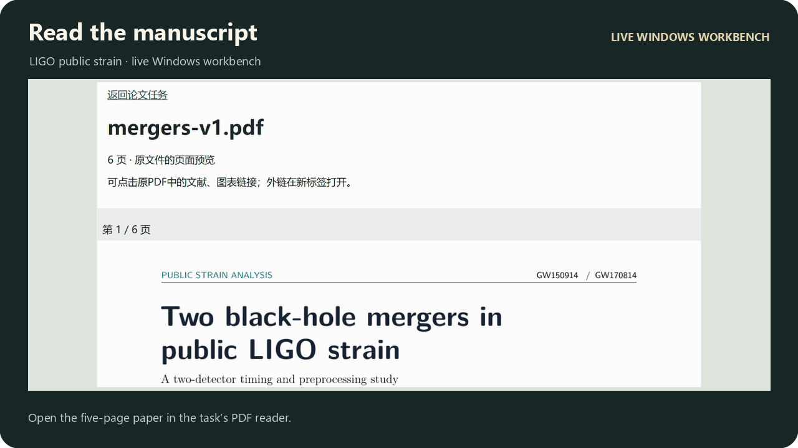

<h1 align="center">
  
</h1>

<p align="center">
  <a href="https://github.com/WUBING2023/PaperSpine/releases/download/v6.0.0-beta.2/paperspine-skill-6.0.0-beta.2.zip"><picture>
    <source media="(prefers-reduced-motion: reduce)" srcset="https://wubing2023.github.io/PaperSpine/v6/activity-still.svg">
    
  </picture></a>
</p>

<p align="center"><strong>Partez d’une question, de données ou d’un brouillon. Obtenez un article modifiable avec des éléments que vous pouvez vérifier.</strong></p>

<p align="center">
  <a href="#install-with-ai"><strong>Démarrage rapide</strong></a> · <a href="#quick-demo">Démonstration</a> · <a href="#research-cases">Cas de recherche</a><br>
  <small><a href="https://wubing2023.github.io/PaperSpine/v6/fr/">Site web</a> · <a href="https://wubing2023.github.io/PaperSpine/v6/fr/install.html">Guide d’installation</a> · <a href="#ways-to-work">Comparer les éditions</a> · <a href="https://wubing2023.github.io/PaperSpine/?lang=fr">Atlas de la communauté</a></small>
</p>

<p align="center">
  <a href="https://github.com/WUBING2023/PaperSpine/releases/tag/v6.0.0-beta.2"></a>
  <a href="https://github.com/WUBING2023/PaperSpine/stargazers"></a>
  <a href="LICENSE"></a>
  <a href="https://github.com/WUBING2023/PaperSpine/actions/workflows/validate.yml"></a>
  <a href="https://wubing2023.github.io/PaperSpine/contributors/fr.html"></a>
  <a href="https://github.com/WUBING2023/PaperSpine/issues?q=is%3Aissue+is%3Aclosed"></a>
  <a href="https://github.com/WUBING2023/PaperSpine/commits/main/"></a>
</p>

<p align="center">
  <sub>V6</sub>
  <a href="README.md"></a>
  <a href="README.zh-CN.md"></a>
  <a href="README.ja.md"></a>
  <a href="README.ko.md"></a>
  <a href="README.es.md"></a>
  <a href="README.fr.md"></a>
  <a href="README.de.md"></a>
  <a href="README.pt.md"></a>
  <a href="README.ru.md"></a>
</p>

<a id="quick-demo"></a>

## Rédiger un article comme un chercheur

<p align="center">
  <picture>
    <source media="(prefers-reduced-motion: reduce)" srcset="paperspine5/core/07_发布页/v6/readme/rounded/paperspine_codex_demo_v3_15s-still.webp">
    
  </picture>
</p>

<p align="center"><small>Followwriting · Relecture des figures · Aperçu du manuscrit · Révision</small></p>

<a id="workflow"></a>

## Fonctionnement de PaperSpine

Utilisez les articles de référence comme modèles de rédaction et étayez les conclusions avec les données de votre propre étude.

<p align="center">
  <picture>
    <source media="(prefers-reduced-motion: reduce)" srcset="paperspine5/core/07_发布页/v6/readme/rounded/paperspine-workflow-8s-zh-still.webp">
    
  </picture>
</p>

<p align="center"><small>Réunir les preuves → Rédiger à partir des références → Créer des figures modifiables → Réviser et livrer</small></p>

<a id="install-with-ai"></a>

## Installer avec votre IA

Collez cette demande dans l’agent que vous utilisez pour vos recherches.

```text
Installe PaperSpine dans cet environnement. Lis d’abord le guide officiel.
https://wubing2023.github.io/PaperSpine/v6/llms.txt

Choisis l’édition adaptée à ma tâche et à mon environnement. Vérifie le ZIP avec SHA-256. Une fois l’installation terminée, confirme la version et indique comment appeler le Skill.
```

[Guide d’installation lisible par l’agent](https://wubing2023.github.io/PaperSpine/v6/llms.txt) · [Manifeste de la version (JSON)](https://wubing2023.github.io/PaperSpine/v6/channel.json)

<a id="ways-to-work"></a>

## Trois façons de travailler

<a id="start-with-skill"></a>

### Démarrage rapide · Skill de bout en bout

Lancez `$paper-spine` dans une conversation avec un agent et fournissez une question, des données ou un brouillon. Obtenez des notes, des analyses, des figures et un manuscrit modifiable dans le périmètre convenu.

[**Télécharger le ZIP**](https://github.com/WUBING2023/PaperSpine/releases/download/v6.0.0-beta.2/paperspine-skill-6.0.0-beta.2.zip) · 

### Recherche spécialisée · Ensemble de Skills

Utilisez `$paper-spine` pour le parcours complet ou lancez une étape directement. Par exemple, `$paper-spine-followwriting` vous aide à réviser une section à partir de vos résultats et d’articles de référence.

[**Télécharger le ZIP**](https://github.com/WUBING2023/PaperSpine/releases/download/v6.0.0-beta.2/paperspine-skills-pack-6.0.0-beta.2.zip) · 

### Espace de révision · Extension web

Ajoutez l’espace de révision local pour examiner les figures, lire les brouillons ou envoyer des demandes de révision dans le navigateur. Il inclut l’ensemble de Skills et se lance avec `$paper-spine-web:paper-spine-web` dans Codex sous Windows x64.

[**Télécharger le ZIP**](https://github.com/WUBING2023/PaperSpine/releases/download/v6.0.0-beta.2/paperspine-web-plugin-6.0.0-beta.2-windows-x64.zip) · 

<details>
<summary><strong>Cinq Skills autonomes et exemples de demandes</strong></summary>

| Skill | Quoi demander |
| --- | --- |
| `$paper-spine-study` | Conçois un test apparié avec ces données et enregistre les résultats par partition. |
| `$paper-spine-followwriting` | Révise l’argument de la section Résultats à l’aide de ces articles de référence. Conserve mes estimations et la portée des affirmations. |
| `$paper-spine-figures` | Crée une figure vectorielle à partir de ces résultats et joins le code de la figure. |
| `$paper-spine-review` | Vérifie quelles affirmations sont étayées par les sources et les figures, puis révise les plus fragiles. |
| `$paper-spine-deliver` | Exporte le manuscrit modifiable, une version de lecture et les pièces justificatives. |

</details>

<a id="installation"></a>

## Installation et mises à jour

Vérifiez le ZIP avec la liste des sommes de contrôle. Décompressez-le, lancez le gestionnaire depuis le dossier extrait avec le chemin du ZIP d’origine et son SHA-256 complet, puis ouvrez une nouvelle conversation.

```text
python -B edition_manager.py install "<original ZIP path>" --sha256 <SHA256>
```

Le gestionnaire requiert Python 3.12 ou plus récent. L’archive web inclut Python pour Windows et requiert la CLI de Codex. Les installations gérées prennent en charge les vérifications automatiques, les mises à jour manuelles, le retour arrière et la désinstallation. Elles conservent brouillons et tâches locales.

[Installer, mettre à jour ou désinstaller](https://wubing2023.github.io/PaperSpine/v6/fr/install.html) · [Sommes de contrôle SHA-256](https://github.com/WUBING2023/PaperSpine/releases/download/v6.0.0-beta.2/checksums.sha256) · [Version V6](https://github.com/WUBING2023/PaperSpine/releases/tag/v6.0.0-beta.2)

## Comment PaperSpine intègre les preuves au manuscrit

- **Définissez le périmètre à partir des matériaux disponibles.** Une question peut demander des données publiques ou une nouvelle analyse. Des résultats existants permettent de passer à la figure, à l’argument ou à la révision voulue. L’agent transmet les fichiers et les décisions entre étapes.
- **Retracez séparément la rédaction et les preuves.** Followwriting indique les passages qui ont guidé la structure ou la formulation. Les affirmations reposent sur les données de l’étude. Gardez l’analyse, les sources des figures et les citations pour la révision.
- **Intégrez la révision au même article.** Enregistrez la figure retenue et les critiques avec le manuscrit modifiable. La révision peut reprendre les preuves, mettre à jour le texte et la figure concernés, et consigner les changements.

L’étude LIGO en donne un exemple. Suivez l’ordre d’arrivée annoncé de l’article aux signaux alignés et aux neuf vérifications de prétraitement. [Preuves et sources de l’étude LIGO](https://wubing2023.github.io/PaperSpine/v6/fr/#gravitational-waves)

<a id="research-cases"></a>

## Intensification des cyclones atlantiques à conditions initiales comparables

Avec le Skill autonome, PaperSpine a comparé 42 saisons de trajectoires NOAA. Sur 6 017 fenêtres comparables de 24 heures, l’écart à 30 nœuds est de +0,81 point (intervalle à 95 % par bootstrap des saisons de −1,69 à +3,43). L’estimation ponctuelle à 25 nœuds change de signe. Les six panneaux tracent 484 trajectoires de 24 heures, distinguent des classes disjointes de hausse et montrent le contraste et l’incertitude à neuf seuils.

<a href="https://wubing2023.github.io/PaperSpine/v6/fr/#showcase"></a>

[Lire l’article](https://wubing2023.github.io/PaperSpine/v6/science/research/atlantic-ri/paper.pdf) · [Figure principale en SVG](paperspine5/core/07_发布页/v6/science/research/atlantic-ri/figure.svg) · [Sensibilité en SVG](paperspine5/core/07_发布页/v6/science/research/atlantic-ri/checks.svg) · [Article modifiable et code d’analyse](https://wubing2023.github.io/PaperSpine/v6/science/research/atlantic-ri/source.zip)

Changez d’étude et passez de la page de titre aux résultats, à la figure principale et à la sensibilité. [Ouvrir la galerie d’études](https://wubing2023.github.io/PaperSpine/v6/fr/?v=research-gallery#showcase)

<a id="edition-field-test"></a>

## Trois articles, trois modes

GPT‑6.1 Sol a utilisé les trois éditions de PaperSpine pour chaque étude. Les [neuf exécutions documentées](paperspine5/core/07_发布页/v6/science/research/README.md#how-the-runs-were-conducted) incluent les articles, les données publiques, les figures originales, le code reproductible et l’historique des révisions.

[Passer des pages aux figures et contrôles de sensibilité](https://wubing2023.github.io/PaperSpine/v6/fr/#showcase)

### Deux fusions de trous noirs à l’échelle de la milliseconde

Pour deux événements publics de LIGO, Hanford a enregistré le signal 7,36 et 7,75 ms après Livingston. Le signe des retards est resté stable pour les neuf prétraitements.

<a href="paperspine5/core/07_发布页/v6/science/research/gravitational-waves/figure.svg"></a>

[Lire l’article](https://wubing2023.github.io/PaperSpine/v6/science/research/gravitational-waves/paper.pdf) · [Figure vectorielle haute résolution](paperspine5/core/07_发布页/v6/science/research/gravitational-waves/figure.svg) · [Sources de l’article et code](https://wubing2023.github.io/PaperSpine/v6/science/research/gravitational-waves/source.zip) · [Données](https://doi.org/10.7935/82H3-HH23)

### La décroissance des répliques dépend du catalogue

Pour M ≥ 1,5 et de 1 à 72 heures après le séisme de Mw 7,1, les exposants ajustés sont de 0,55 dans ComCat et de 0,48 dans le catalogue relocalisé de Shelly.

<a href="paperspine5/core/07_发布页/v6/science/research/ridgecrest/figure.svg"></a>

[Lire l’article](https://wubing2023.github.io/PaperSpine/v6/science/research/ridgecrest/paper.pdf) · [Figure vectorielle haute résolution](paperspine5/core/07_发布页/v6/science/research/ridgecrest/figure.svg) · [Sources de l’article et code](https://wubing2023.github.io/PaperSpine/v6/science/research/ridgecrest/source.zip) · [Données](https://doi.org/10.5066/P9JN6H0N)

### Deux empreintes régionales de la fumée en juin

Par rapport à la médiane du 20 au 22 juin à chaque station, le contraste Atlantique–Grands Lacs des écarts de PM₂.₅ est passé de +74,1 µg/m³ du 6 au 8 juin à −69,1 µg/m³ du 27 au 29.

<a href="paperspine5/core/07_发布页/v6/science/research/smoke/figure.svg"></a>

[Lire l’article](https://wubing2023.github.io/PaperSpine/v6/science/research/smoke/paper.pdf) · [Figure vectorielle haute résolution](paperspine5/core/07_发布页/v6/science/research/smoke/figure.svg) · [Sources de l’article et code](https://wubing2023.github.io/PaperSpine/v6/science/research/smoke/source.zip) · [Données](https://aqs.epa.gov/aqsweb/airdata/download_files.html)

[Notes des trois modes](paperspine5/core/07_发布页/v6/science/research/README.md) · [Test de bon fonctionnement de l’édition antérieure](paperspine5/core/07_发布页/v6/science/edition-field-test.md)

<a id="paper-example"></a>
<a id="feature-demos"></a>

## Démonstrations des fonctionnalités

<table><tr>
  <td width="50%"><a href="paperspine5/core/07_发布页/v6/science/followwriting-hd.gif"><picture>
    <source media="(prefers-reduced-motion: reduce)" srcset="paperspine5/core/07_发布页/v6/readme/rounded/followwriting-hd-still.webp">
    
  </picture></a><br><strong>Followwriting</strong></td>
  <td width="50%"><a href="paperspine5/core/07_发布页/v6/science/figures-hd.gif"><picture>
    <source media="(prefers-reduced-motion: reduce)" srcset="paperspine5/core/07_发布页/v6/readme/rounded/figures-hd-still.webp">
    
  </picture></a><br><strong>Relire les figures</strong></td>
</tr><tr>
  <td width="50%"><a href="paperspine5/core/07_发布页/v6/science/workbench-hd.gif"><picture>
    <source media="(prefers-reduced-motion: reduce)" srcset="paperspine5/core/07_发布页/v6/readme/rounded/workbench-hd-still.webp">
    
  </picture></a><br><strong>Aperçu du manuscrit</strong></td>
  <td width="50%"><a href="paperspine5/core/07_发布页/v6/science/revision-hd.gif"><picture>
    <source media="(prefers-reduced-motion: reduce)" srcset="paperspine5/core/07_发布页/v6/readme/rounded/revision-hd-still.webp">
    
  </picture></a><br><strong>Relire et corriger</strong></td>
</tr></table>

Followwriting montre comment s’appuyer sur la structure d’un article de référence en rédigeant à partir des résultats de l’étude. Les autres clips proviennent de l’espace de travail Windows publié. [Voir une demande suivie d’une révision](https://wubing2023.github.io/PaperSpine/v6/fr/#revision) · [Captures de l’espace de travail en taille réelle](https://wubing2023.github.io/PaperSpine/v6/fr/#examples)

## Développement et communauté

<a href="https://wubing2023.github.io/PaperSpine/?lang=fr"></a>

[Voir les contributions à chaque mise à jour de V6](https://wubing2023.github.io/PaperSpine/contributors/fr.html#v6-contributions) · [Explorer l’atlas des étoiles](https://wubing2023.github.io/PaperSpine/?lang=fr) · [Données de l’atlas (JSON)](https://wubing2023.github.io/PaperSpine/api/v1/atlas.json)

[Site officiel](https://wubing2023.github.io/PaperSpine/v6/fr/) · [Sources V6](paperspine5/core/01_PaperSpine4/src/skill-editions/) · [Gestionnaire d’installation](paperspine5/core/06_插件化/release/edition_manager.py) · [Sources du site](paperspine5/core/07_发布页/v6/) · [Signaler un problème](https://github.com/WUBING2023/PaperSpine/issues) · <a id="press-kit"></a>[Ressources du projet](https://wubing2023.github.io/PaperSpine/v6/science/paperspine-v6-press-kit.zip)

<details>
<summary>Documentation et index des sources de V5</summary>

- Méthodes et documents de travail · [writing_rationale_matrix](src/skill/references/rewrite.md) · [citation_support_bank](src/skill/references/citation-support-bank.md) · [translation_package](src/skill/references/translation-package.md)
- Outils d’export et de vérification · [artifact_check.py](src/scripts/artifact_check.py) · [reference_inventory.py](src/scripts/reference_inventory.py) · [citation_bank_check.py](src/scripts/citation_bank_check.py) · [latex_guard.py](src/scripts/latex_guard.py) · [word_guard.py](src/scripts/word_guard.py)
- Anciennes distributions par environnement · [Codex](dist/codex/skills/paper-spine/) · [Claude](dist/claude/skills/paper-spine/) · [OpenClaw](dist/openclaw/skills/paper-spine/) · [Commande Claude](dist/claude/commands/paperspine.md)
- Installateurs V5 · [install.ps1](install.ps1) · [install.sh](install.sh)

[Archives de V5](https://wubing2023.github.io/PaperSpine/v5/en/?legacy=1)

</details>

## Licence

[MIT](LICENSE) · [Instrument Serif](paperspine5/core/07_发布页/v6/fonts/instrument-OFL.txt) · [Noto Serif SC](paperspine5/core/07_发布页/v6/fonts/notoserifsc-OFL.txt)
