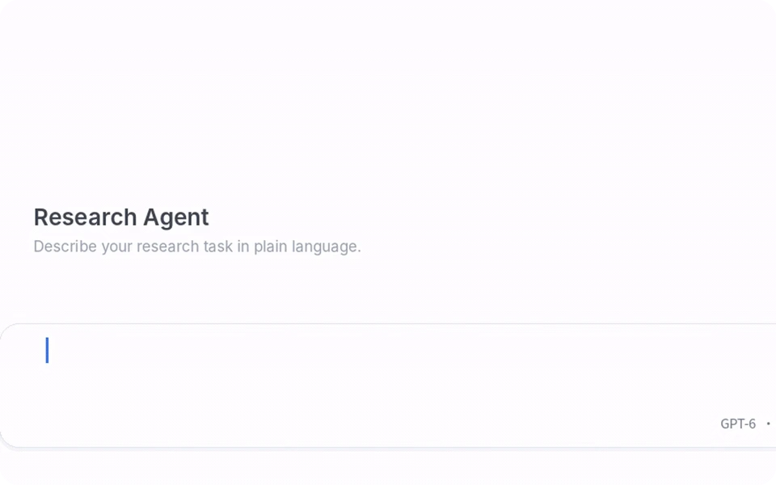

<h1 align="center">
  
</h1>

<p align="center">
  <a href="https://github.com/WUBING2023/PaperSpine/releases/download/v6.0.0-beta.2/paperspine-skill-6.0.0-beta.2.zip"><picture>
    <source media="(prefers-reduced-motion: reduce)" srcset="https://wubing2023.github.io/PaperSpine/v6/activity-still.svg">
    
  </picture></a>
</p>

<p align="center"><strong>연구 질문, 데이터, 초안에서 시작해 근거를 확인할 수 있는 편집 가능한 논문을 만드세요.</strong></p>

<p align="center">
  <a href="#install-with-ai"><strong>빠른 시작</strong></a> · <a href="#quick-demo">데모</a> · <a href="#research-cases">연구 사례</a><br>
  <small><a href="https://wubing2023.github.io/PaperSpine/v6/ko/">웹사이트</a> · <a href="https://wubing2023.github.io/PaperSpine/v6/ko/install.html">설치 가이드</a> · <a href="#ways-to-work">에디션 비교</a> · <a href="https://wubing2023.github.io/PaperSpine/?lang=ko">커뮤니티 지도</a></small>
</p>

<p align="center">
  <a href="https://github.com/WUBING2023/PaperSpine/releases/tag/v6.0.0-beta.2"></a>
  <a href="https://github.com/WUBING2023/PaperSpine/stargazers"></a>
  <a href="LICENSE"></a>
  <a href="https://github.com/WUBING2023/PaperSpine/actions/workflows/validate.yml"></a>
  <a href="https://wubing2023.github.io/PaperSpine/contributors/ko.html"></a>
  <a href="https://github.com/WUBING2023/PaperSpine/issues?q=is%3Aissue+is%3Aclosed"></a>
  <a href="https://github.com/WUBING2023/PaperSpine/commits/main/"></a>
</p>

<p align="center">
  <sub>V6</sub>
  <a href="README.md"></a>
  <a href="README.zh-CN.md"></a>
  <a href="README.ja.md"></a>
  <a href="README.ko.md"></a>
  <a href="README.es.md"></a>
  <a href="README.fr.md"></a>
  <a href="README.de.md"></a>
  <a href="README.pt.md"></a>
  <a href="README.ru.md"></a>
</p>

<a id="quick-demo"></a>

## 연구자처럼 논문 쓰기

<p align="center">
  <picture>
    <source media="(prefers-reduced-motion: reduce)" srcset="paperspine5/core/07_发布页/v6/readme/rounded/paperspine_codex_demo_v3_15s-still.webp">
    
  </picture>
</p>

<p align="center"><small>Followwriting · 그림 검토 · 원고 미리 보기 · 수정</small></p>

<a id="workflow"></a>

## PaperSpine의 작동 방식

참고 논문을 글쓰기의 본보기로 삼고, 결론은 자기 연구의 근거로 뒷받침하세요.

<p align="center">
  <picture>
    <source media="(prefers-reduced-motion: reduce)" srcset="paperspine5/core/07_发布页/v6/readme/rounded/paperspine-workflow-8s-zh-still.webp">
    
  </picture>
</p>

<p align="center"><small>근거 수집 → 참고 논문으로 집필 → 편집 가능한 그림 제작 → 검토 및 납품</small></p>

<a id="install-with-ai"></a>

## AI에게 설치 요청

연구에 사용하는 에이전트에 이 요청을 붙여 넣으세요.

```text
현재 환경에 PaperSpine을 설치하세요. 먼저 공식 가이드를 읽으세요.
https://wubing2023.github.io/PaperSpine/v6/llms.txt

작업과 환경에 맞는 버전을 선택하고 ZIP을 SHA-256으로 검증하세요. 설치 후 버전을 확인하고 Skill 호출 방법을 알려 주세요.
```

[에이전트가 읽을 수 있는 설치 안내](https://wubing2023.github.io/PaperSpine/v6/llms.txt) · [릴리스 매니페스트(JSON)](https://wubing2023.github.io/PaperSpine/v6/channel.json)

<a id="ways-to-work"></a>

## 세 가지 사용 방식

<a id="start-with-skill"></a>

### 빠른 시작 · 전체 워크플로 Skill

에이전트 채팅에서 질문, 데이터 또는 초안과 함께 `$paper-spine`을 호출하세요. 합의한 범위의 연구 노트, 분석, 그림과 편집 가능한 원고를 제공합니다.

[**ZIP 다운로드**](https://github.com/WUBING2023/PaperSpine/releases/download/v6.0.0-beta.2/paperspine-skill-6.0.0-beta.2.zip) · 

### 단계별 작업 · Skills 팩

전체 워크플로는 `$paper-spine`로 실행합니다. 특정 단계만 호출할 수도 있습니다. 예를 들어 `$paper-spine-followwriting`는 자기 결과와 참고 논문으로 한 절을 수정합니다.

[**ZIP 다운로드**](https://github.com/WUBING2023/PaperSpine/releases/download/v6.0.0-beta.2/paperspine-skills-pack-6.0.0-beta.2.zip) · 

### 로컬 작업 공간 · 웹 플러그인

선택형 로컬 작업 공간을 추가하면 브라우저에서 그림과 초안을 보고 수정 의견을 보낼 수 있습니다. Skills 팩을 포함하며 Windows x64의 Codex에서 `$paper-spine-web:paper-spine-web`을 호출합니다.

[**ZIP 다운로드**](https://github.com/WUBING2023/PaperSpine/releases/download/v6.0.0-beta.2/paperspine-web-plugin-6.0.0-beta.2-windows-x64.zip) · 

<details>
<summary><strong>개별 단계 Skill 5개와 프롬프트 예시</strong></summary>

| Skill | 요청 예시 |
| --- | --- |
| `$paper-spine-study` | 이 데이터셋으로 대응표본 검정을 설계하고 분할별 결과를 저장하세요. |
| `$paper-spine-followwriting` | 이 참고 논문들을 활용해 결과 절의 논리를 다듬으세요. 추정치와 주장의 범위는 유지하세요. |
| `$paper-spine-figures` | 이 분석 결과에서 벡터 그림을 만들고 그림 코드도 포함하세요. |
| `$paper-spine-review` | 출처와 그림이 어떤 주장을 뒷받침하는지 확인하고 근거가 약한 주장을 수정하세요. |
| `$paper-spine-deliver` | 편집 가능한 원고, 열람용 사본, 근거 자료를 내보내세요. |

</details>

<a id="installation"></a>

## 설치와 업데이트

ZIP을 체크섬 목록과 대조한 뒤 압축을 푸세요. 압축을 푼 폴더에서 관리자를 실행할 때 원본 ZIP 경로와 전체 SHA-256 값을 전달하세요. 그런 다음 호스트에서 새 채팅을 여세요.

```text
python -B edition_manager.py install "<original ZIP path>" --sha256 <SHA256>
```

관리자에는 Python 3.12 이상이 필요합니다. 웹 ZIP에는 Windows용 Python이 포함되며 Codex CLI가 필요합니다. 관리자가 처리한 설치는 자동 업데이트 확인, 수동 업데이트, 롤백, 제거를 지원합니다. 초안과 로컬 작업은 보존됩니다.

[설치·업데이트·제거](https://wubing2023.github.io/PaperSpine/v6/ko/install.html) · [SHA-256 체크섬](https://github.com/WUBING2023/PaperSpine/releases/download/v6.0.0-beta.2/checksums.sha256) · [V6 릴리스](https://github.com/WUBING2023/PaperSpine/releases/tag/v6.0.0-beta.2)

## PaperSpine이 근거를 논문에 연결하는 방식

- **출발 자료에 맞춰 범위를 정합니다.** 연구 질문은 공개 데이터 수집이나 새 분석으로 이어질 수 있습니다. 기존 결과가 있다면 필요한 그림, 논리 구성, 검토로 바로 갈 수 있습니다. 에이전트는 단계 사이에 파일과 결정을 이어 갑니다.
- **글쓰기 판단과 과학적 근거를 각각 추적합니다.** Followwriting은 구성과 표현을 참고한 문헌 구절을 보여 줍니다. 주장은 연구 자체의 증거에서 나옵니다. 분석 자료, 그림 소스, 인용을 검토할 수 있도록 보관하세요.
- **같은 논문에서 검토를 이어 갑니다.** 선택한 그림과 검토 의견을 편집 가능한 원고와 함께 저장하세요. 수정할 때 근거를 다시 보고 영향받은 텍스트와 그림을 업데이트하며 변경 기록을 남길 수 있습니다.

LIGO 사례에서 실제 과정을 볼 수 있습니다. 논문의 도달 순서를 정렬한 변형률과 9가지 전처리 점검으로 따라가 보세요. [LIGO 근거 및 소스 파일](https://wubing2023.github.io/PaperSpine/v6/ko/#gravitational-waves)

<a id="research-cases"></a>

## 비슷한 초기 조건에서 비교한 대서양 열대저기압 강화

단독 Skill로 NOAA 최적 경로 자료 42시즌을 비교했습니다. 초기 조건이 비슷한 24시간 구간 6,017개에서 30노트 기준의 차이는 +0.81%p였습니다(시즌 부트스트랩 95% 구간 −1.69~+3.43). 25노트 점추정치의 부호는 반전됐습니다. 6개 패널은 관측된 24시간 경로 484개, 겹치지 않는 풍속 증가 구간, 9개 임계값에서의 차이와 불확실성을 보여 줍니다.

<a href="https://wubing2023.github.io/PaperSpine/v6/ko/#showcase"></a>

[논문 읽기](https://wubing2023.github.io/PaperSpine/v6/science/research/atlantic-ri/paper.pdf) · [주 그림 SVG](paperspine5/core/07_发布页/v6/science/research/atlantic-ri/figure.svg) · [민감도 그림 SVG](paperspine5/core/07_发布页/v6/science/research/atlantic-ri/checks.svg) · [편집 가능한 논문과 분석 코드](https://wubing2023.github.io/PaperSpine/v6/science/research/atlantic-ri/source.zip)

연구 카드를 바꾸면서 표지, 결과, 주 그림, 민감도 그림을 비교하세요. [연구 갤러리 열기](https://wubing2023.github.io/PaperSpine/v6/ko/?v=research-gallery#showcase)

<a id="edition-field-test"></a>

## 연구 논문 세 편, 실행 방식 세 가지

GPT‑6.1 Sol은 연구마다 PaperSpine의 세 에디션을 모두 사용했습니다. [문서화한 9회 실행 기록](paperspine5/core/07_发布页/v6/science/research/README.md#how-the-runs-were-conducted)에는 논문, 공개 데이터, 원본 그림, 재현 코드와 수정 기록이 들어 있습니다.

[원고 페이지, 그림, 민감도 점검 전환](https://wubing2023.github.io/PaperSpine/v6/ko/#showcase)

### 두 블랙홀 병합의 밀리초 단위 도달 시차

두 공개 LIGO 사건에서 핸퍼드는 리빙스턴보다 각각 7.36ms, 7.75ms 늦게 기록했습니다. 9가지 전처리에서 두 지연의 부호가 모두 유지됐습니다.

<a href="paperspine5/core/07_发布页/v6/science/research/gravitational-waves/figure.svg"></a>

[논문 읽기](https://wubing2023.github.io/PaperSpine/v6/science/research/gravitational-waves/paper.pdf) · [고해상도 벡터 그림](paperspine5/core/07_发布页/v6/science/research/gravitational-waves/figure.svg) · [논문 소스와 코드](https://wubing2023.github.io/PaperSpine/v6/science/research/gravitational-waves/source.zip) · [데이터](https://doi.org/10.7935/82H3-HH23)

### 목록에 따라 달라지는 여진 감쇠

보고 규모 M ≥ 1.5, Mw 7.1 본진 후 1~72시간의 범위에서 적합한 감쇠 지수는 ComCat 0.55, 재배치한 Shelly 목록 0.48이었습니다.

<a href="paperspine5/core/07_发布页/v6/science/research/ridgecrest/figure.svg"></a>

[논문 읽기](https://wubing2023.github.io/PaperSpine/v6/science/research/ridgecrest/paper.pdf) · [고해상도 벡터 그림](paperspine5/core/07_发布页/v6/science/research/ridgecrest/figure.svg) · [논문 소스와 코드](https://wubing2023.github.io/PaperSpine/v6/science/research/ridgecrest/source.zip) · [데이터](https://doi.org/10.5066/P9JN6H0N)

### 6월 산불 연기의 두 가지 지역 분포

각 관측소의 6월 20~22일 중앙값을 기준으로 PM₂.₅ 편차의 대서양 연안과 오대호 권역 차이는 6월 6~8일 +74.1 µg/m³에서 27~29일 −69.1 µg/m³로 반전됐습니다.

<a href="paperspine5/core/07_发布页/v6/science/research/smoke/figure.svg"></a>

[논문 읽기](https://wubing2023.github.io/PaperSpine/v6/science/research/smoke/paper.pdf) · [고해상도 벡터 그림](paperspine5/core/07_发布页/v6/science/research/smoke/figure.svg) · [논문 소스와 코드](https://wubing2023.github.io/PaperSpine/v6/science/research/smoke/source.zip) · [데이터](https://aqs.epa.gov/aqsweb/airdata/download_files.html)

[세 가지 실행 방식 기록](paperspine5/core/07_发布页/v6/science/research/README.md) · [이전 버전 기본 동작 테스트](paperspine5/core/07_发布页/v6/science/edition-field-test.md)

<a id="paper-example"></a>
<a id="feature-demos"></a>

## 기능 데모

<table><tr>
  <td width="50%"><a href="paperspine5/core/07_发布页/v6/science/followwriting-hd.gif"><picture>
    <source media="(prefers-reduced-motion: reduce)" srcset="paperspine5/core/07_发布页/v6/readme/rounded/followwriting-hd-still.webp">
    
  </picture></a><br><strong>Followwriting</strong></td>
  <td width="50%"><a href="paperspine5/core/07_发布页/v6/science/figures-hd.gif"><picture>
    <source media="(prefers-reduced-motion: reduce)" srcset="paperspine5/core/07_发布页/v6/readme/rounded/figures-hd-still.webp">
    
  </picture></a><br><strong>그림 검토</strong></td>
</tr><tr>
  <td width="50%"><a href="paperspine5/core/07_发布页/v6/science/workbench-hd.gif"><picture>
    <source media="(prefers-reduced-motion: reduce)" srcset="paperspine5/core/07_发布页/v6/readme/rounded/workbench-hd-still.webp">
    
  </picture></a><br><strong>원고 미리 보기</strong></td>
  <td width="50%"><a href="paperspine5/core/07_发布页/v6/science/revision-hd.gif"><picture>
    <source media="(prefers-reduced-motion: reduce)" srcset="paperspine5/core/07_发布页/v6/readme/rounded/revision-hd-still.webp">
    
  </picture></a><br><strong>검토 및 수정</strong></td>
</tr></table>

Followwriting은 자기 연구의 결과를 쓰면서 참고 논문의 구성을 활용하는 과정을 보여 줍니다. 나머지 영상은 공개 Windows 작업 공간을 녹화한 것입니다. [피드백에서 수정까지 보기](https://wubing2023.github.io/PaperSpine/v6/ko/#revision) · [작업 공간 원본 크기 화면](https://wubing2023.github.io/PaperSpine/v6/ko/#examples)

## 개발과 커뮤니티

<a href="https://wubing2023.github.io/PaperSpine/?lang=ko"></a>

[V6 업데이트별 기여자 보기](https://wubing2023.github.io/PaperSpine/contributors/ko.html#v6-contributions) · [스타 지도 탐색](https://wubing2023.github.io/PaperSpine/?lang=ko) · [지도 데이터(JSON)](https://wubing2023.github.io/PaperSpine/api/v1/atlas.json)

[공식 웹사이트](https://wubing2023.github.io/PaperSpine/v6/ko/) · [V6 소스](paperspine5/core/01_PaperSpine4/src/skill-editions/) · [설치 관리자](paperspine5/core/06_插件化/release/edition_manager.py) · [웹사이트 소스](paperspine5/core/07_发布页/v6/) · [문제 신고](https://github.com/WUBING2023/PaperSpine/issues) · <a id="press-kit"></a>[프로젝트 자료](https://wubing2023.github.io/PaperSpine/v6/science/paperspine-v6-press-kit.zip)

<details>
<summary>V5 문서와 소스 색인</summary>

- 방법과 작업 산출물 · [writing_rationale_matrix](src/skill/references/rewrite.md) · [citation_support_bank](src/skill/references/citation-support-bank.md) · [translation_package](src/skill/references/translation-package.md)
- 내보내기 및 검증 도구 · [artifact_check.py](src/scripts/artifact_check.py) · [reference_inventory.py](src/scripts/reference_inventory.py) · [citation_bank_check.py](src/scripts/citation_bank_check.py) · [latex_guard.py](src/scripts/latex_guard.py) · [word_guard.py](src/scripts/word_guard.py)
- 이전 호스트용 Skill · [Codex](dist/codex/skills/paper-spine/) · [Claude](dist/claude/skills/paper-spine/) · [OpenClaw](dist/openclaw/skills/paper-spine/) · [Claude 명령](dist/claude/commands/paperspine.md)
- V5 설치 프로그램 · [install.ps1](install.ps1) · [install.sh](install.sh)

[V5 아카이브](https://wubing2023.github.io/PaperSpine/v5/en/?legacy=1)

</details>

## 라이선스

[MIT](LICENSE) · [Instrument Serif](paperspine5/core/07_发布页/v6/fonts/instrument-OFL.txt) · [Noto Serif SC](paperspine5/core/07_发布页/v6/fonts/notoserifsc-OFL.txt)
