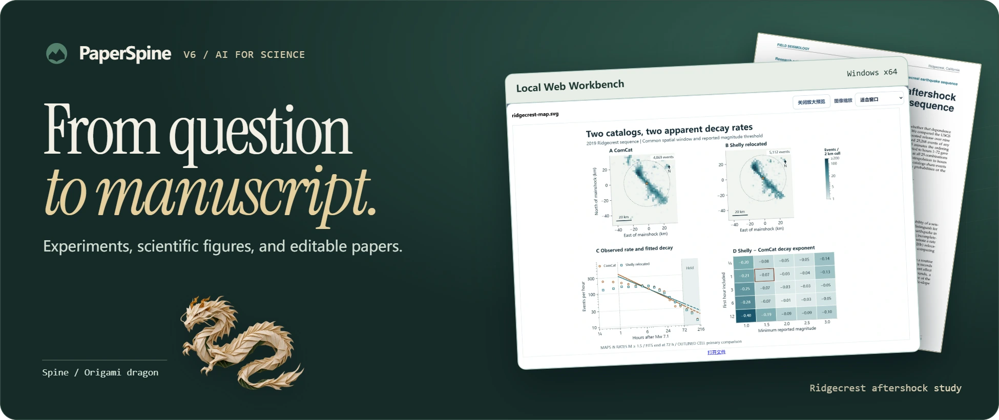

<div align="center">

**English** · [中文](README.zh-CN.md)

</div>

<p align="center">
  <a href="https://wubing2023.github.io/PaperSpine/v6/"></a>
</p>

<p align="center">
  <strong>Start with a research question, data, or a draft.</strong><br>
  Run experiments, review scientific figures, and deliver an editable paper with the evidence attached.
</p>

<p align="center">
  <a href="https://github.com/WUBING2023/PaperSpine/releases/tag/v6.0.0-beta.2"></a>
  <a href="LICENSE"></a>
  <a href="https://wubing2023.github.io/PaperSpine/v6/#edition-web"></a>
  <a href="https://github.com/WUBING2023/PaperSpine/issues"></a>
</p>

<p align="center">
  <a href="https://github.com/WUBING2023/PaperSpine/stargazers"><strong>6,000+ GitHub stars</strong></a> ·
  <a href="#research-cases"><strong>3 studies using public data</strong></a> ·
  <a href="paperspine5/core/07_发布页/v6/science/research/README.md#how-the-runs-were-conducted"><strong>9 documented edition runs</strong></a>
</p>

<p align="center">
  <a href="#ways-to-work"><strong>Get PaperSpine</strong></a> ·
  <a href="#feature-demos">Feature demos</a> ·
  <a href="#press-kit">Press kit</a> ·
  <a href="https://wubing2023.github.io/PaperSpine/v6/">Website</a> ·
  <a href="https://wubing2023.github.io/PaperSpine/">Stargazer atlas</a> ·
  <a href="https://wubing2023.github.io/PaperSpine/contributors/">Contributors</a>
</p>

<a id="ways-to-work"></a>

## Three ways to work

| Edition | Start here | Deliverables |
| :--- | :--- | :--- |
| **Quick Start · Full Workflow Skill**<br>[Download ZIP](https://github.com/WUBING2023/PaperSpine/releases/download/v6.0.0-beta.2/paperspine-skill-6.0.0-beta.2.zip)<br> | `$paper-spine`<br>Give it a question, data, or an existing draft in an agent chat. | Study notes, analysis, figures, and an editable manuscript for the agreed scope. |
| **For Research Experts · Skills Pack**<br>[Download ZIP](https://github.com/WUBING2023/PaperSpine/releases/download/v6.0.0-beta.2/paperspine-skills-pack-6.0.0-beta.2.zip)<br> | `$paper-spine` for the full workflow or `$paper-spine-followwriting` to revise a section. | The output you need at each stage, with the sources and files kept for the next stage. |
| **Full Workbench · Web Plugin**<br>[Download ZIP](https://github.com/WUBING2023/PaperSpine/releases/download/v6.0.0-beta.2/paperspine-web-plugin-6.0.0-beta.2-windows-x64.zip)<br> | `$paper-spine-web:paper-spine-web` in Codex on Windows x64. | The Skills Pack plus a local workbench for choices, figure zoom, manuscript preview, downloads, and revisions. |

<details>
<summary><strong>Five stage Skills with example prompts</strong></summary>

| Skill | What to ask for |
| --- | --- |
| `$paper-spine-study` | Design a paired test using this dataset and save the split-level results. |
| `$paper-spine-followwriting` | Use these reference papers to revise the Results argument. Keep my estimates and claim scope. |
| `$paper-spine-figures` | Make a vector figure from these analysis outputs and include the figure code. |
| `$paper-spine-review` | Check which claims the sources and figures support, then revise the weak ones. |
| `$paper-spine-deliver` | Export the editable manuscript, a reading copy, and the supporting artifacts. |

</details>

<a id="installation"></a>

## Installation and updates

Extract your chosen ZIP. Run its manager from the extracted folder, using the original ZIP and its SHA-256. Then open a fresh host chat.

```text
python -B edition_manager.py install "<original ZIP path>" --sha256 <SHA256>
```

The manager requires Python 3.12+. The Web archive includes Windows Python and requires the Codex CLI. Managed installations support automatic update checks, manual upgrades, rollback, and uninstall. Drafts and local tasks are retained.

[Install, update, or uninstall](INSTALL-V6.en.md) · [SHA-256 checksums](https://github.com/WUBING2023/PaperSpine/releases/download/v6.0.0-beta.2/checksums.sha256) · [V6 release](https://github.com/WUBING2023/PaperSpine/releases/tag/v6.0.0-beta.2)

<a id="edition-field-test"></a>
<a id="research-cases"></a>

## Three research papers, three modes

GPT‑6.1 Sol used the Full Workflow Skill, modular Skills, and the local Web Workbench for each study. Explore the paper figures, open data, reproducible code, and revision records.

### Two black-hole mergers, millisecond timing

Hanford lagged Livingston by 7.36 and 7.75 ms in two public LIGO events. Both lag signs held across nine preprocessing choices.

<a href="paperspine5/core/07_发布页/v6/science/research/gravitational-waves/figure.svg"></a>

[Read paper](https://wubing2023.github.io/PaperSpine/v6/science/research/gravitational-waves/paper.pdf) · [High-resolution vector](paperspine5/core/07_发布页/v6/science/research/gravitational-waves/figure.svg) · [Paper source and code](https://wubing2023.github.io/PaperSpine/v6/science/research/gravitational-waves/source.zip) · [Data](https://doi.org/10.7935/82H3-HH23)

### Aftershock decay depends on the catalog

At reported M ≥ 1.5 and 1–72 hours after the Mw 7.1 event, fitted decay exponents were 0.55 in ComCat and 0.48 in the relocated Shelly catalog.

<a href="paperspine5/core/07_发布页/v6/science/research/ridgecrest/figure.svg"></a>

[Read paper](https://wubing2023.github.io/PaperSpine/v6/science/research/ridgecrest/paper.pdf) · [High-resolution vector](paperspine5/core/07_发布页/v6/science/research/ridgecrest/figure.svg) · [Paper source and code](https://wubing2023.github.io/PaperSpine/v6/science/research/ridgecrest/source.zip) · [Data](https://doi.org/10.5066/P9JN6H0N)

### June smoke, two different footprints

The Atlantic–Great Lakes PM₂.₅ departure reversed from +74.1 µg/m³ on June 6–8 to −69.1 µg/m³ on June 27–29.

<a href="paperspine5/core/07_发布页/v6/science/research/smoke/figure.svg"></a>

[Read paper](https://wubing2023.github.io/PaperSpine/v6/science/research/smoke/paper.pdf) · [High-resolution vector](paperspine5/core/07_发布页/v6/science/research/smoke/figure.svg) · [Paper source and code](https://wubing2023.github.io/PaperSpine/v6/science/research/smoke/source.zip) · [Data](https://aqs.epa.gov/aqsweb/airdata/download_files.html)

[Three-mode run notes](paperspine5/core/07_发布页/v6/science/research/README.md) · [Earlier edition smoke test](paperspine5/core/07_发布页/v6/science/edition-field-test.md)

<a id="paper-example"></a>
<a id="feature-demos"></a>

## Feature demos

<table><tr>
  <td width="50%"><a href="paperspine5/core/07_发布页/v6/science/followwriting-hd.gif"><picture>
    <source media="(prefers-reduced-motion: reduce)" srcset="paperspine5/core/07_发布页/v6/science/followwriting-hd-still.webp">
    
  </picture></a><br><strong>Followwriting</strong></td>
  <td width="50%"><a href="paperspine5/core/07_发布页/v6/science/figures-hd.gif"><picture>
    <source media="(prefers-reduced-motion: reduce)" srcset="paperspine5/core/07_发布页/v6/science/figures-hd-still.webp">
    
  </picture></a><br><strong>Figure review</strong></td>
</tr><tr>
  <td width="50%"><a href="paperspine5/core/07_发布页/v6/science/workbench-hd.gif"><picture>
    <source media="(prefers-reduced-motion: reduce)" srcset="paperspine5/core/07_发布页/v6/science/workbench-hd-still.webp">
    
  </picture></a><br><strong>Manuscript preview</strong></td>
  <td width="50%"><a href="paperspine5/core/07_发布页/v6/science/revision-hd.gif"><picture>
    <source media="(prefers-reduced-motion: reduce)" srcset="paperspine5/core/07_发布页/v6/science/revision-hd-still.webp">
    
  </picture></a><br><strong>Review and revise</strong></td>
</tr></table>

Followwriting illustrates how to use a reference’s structure while writing from the study’s own results. The other clips come from the released Windows workbench. [Watch a feedback-to-revision run](https://wubing2023.github.io/PaperSpine/v6/#revision) · [Full-size workbench screenshots](https://wubing2023.github.io/PaperSpine/v6/#examples)

<a id="press-kit"></a>

## Press kit

> PaperSpine is an open-source AI for Science workflow. It helps research agents run experiments, create scientific figures, and deliver editable papers. Choose a full workflow Skill, individual Skills, or a local workbench.

[**Download the press kit**](https://wubing2023.github.io/PaperSpine/v6/science/paperspine-v6-press-kit.zip) · [Bilingual intro and captions](paperspine5/core/07_发布页/v6/science/press-copy.md) · [Landscape cover](paperspine5/core/07_发布页/v6/science/press-cover.png) · [Portrait cover](paperspine5/core/07_发布页/v6/science/press-portrait.png) · [Spine transparent PNG](paperspine5/core/07_发布页/v6/science/spine.png)

## Development and community

<a href="https://wubing2023.github.io/PaperSpine/"></a>

[Explore the stargazer atlas](https://wubing2023.github.io/PaperSpine/) · [View the contributors roster](https://wubing2023.github.io/PaperSpine/contributors/)

[V6 sources](paperspine5/core/01_PaperSpine4/src/skill-editions/) · [Install manager](paperspine5/core/06_插件化/release/edition_manager.py) · [Website source](paperspine5/core/07_发布页/v6/) · [Report an issue](https://github.com/WUBING2023/PaperSpine/issues)

<details>
<summary>V5 documentation and source index</summary>

- Methods and working artifacts · [writing_rationale_matrix](src/skill/references/rewrite.md) · [citation_support_bank](src/skill/references/citation-support-bank.md) · [translation_package](src/skill/references/translation-package.md)
- Export and verification tools · [artifact_check.py](src/scripts/artifact_check.py) · [reference_inventory.py](src/scripts/reference_inventory.py) · [citation_bank_check.py](src/scripts/citation_bank_check.py) · [latex_guard.py](src/scripts/latex_guard.py) · [word_guard.py](src/scripts/word_guard.py)
- Legacy host projections · [Codex](dist/codex/skills/paper-spine/) · [Claude](dist/claude/skills/paper-spine/) · [OpenClaw](dist/openclaw/skills/paper-spine/) · [Claude command](dist/claude/commands/paperspine.md)
- V5 installers · [install.ps1](install.ps1) · [install.sh](install.sh)

[V5 archive](https://wubing2023.github.io/PaperSpine/v5/en/?legacy=1) · [日本語](README.ja.md) · [한국어](README.ko.md) · [Español](README.es.md) · [Français](README.fr.md) · [Deutsch](README.de.md) · [Русский](README.ru.md) · [Português](README.pt.md)

</details>

## License

[MIT](LICENSE) · [Instrument Serif](paperspine5/core/07_发布页/v6/fonts/instrument-OFL.txt) · [Noto Serif SC](paperspine5/core/07_发布页/v6/fonts/notoserifsc-OFL.txt)
