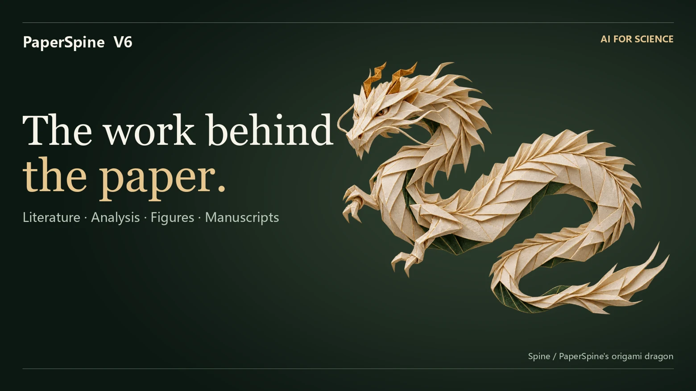
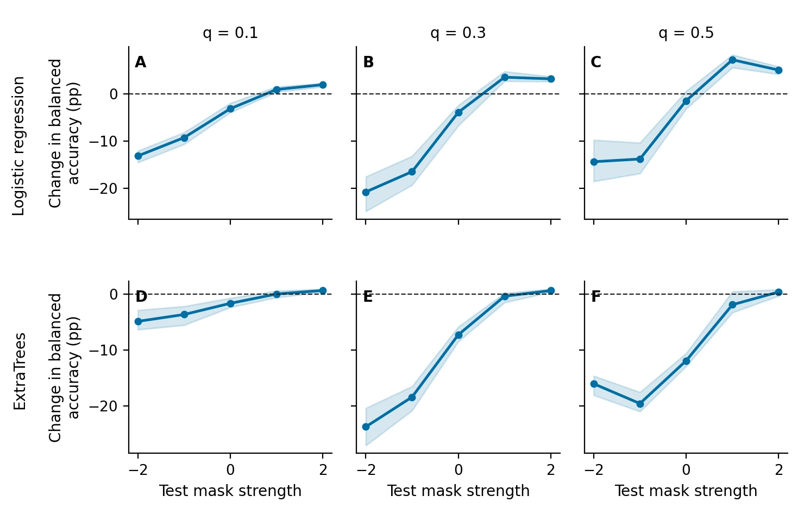
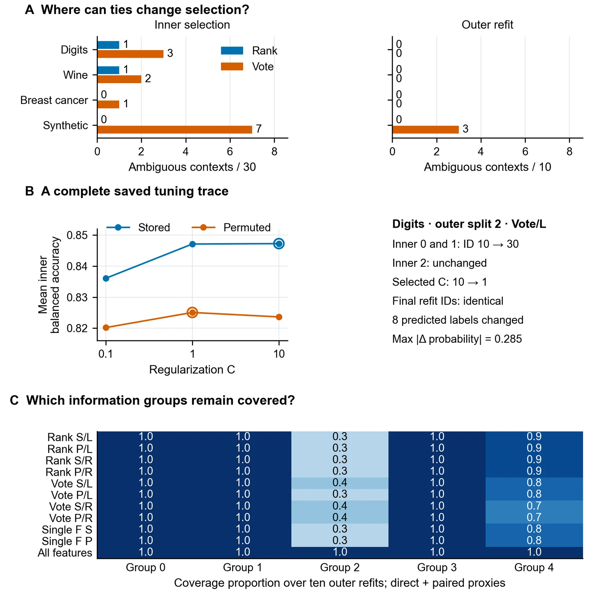
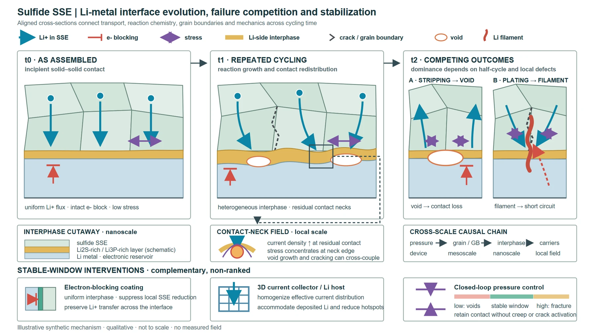
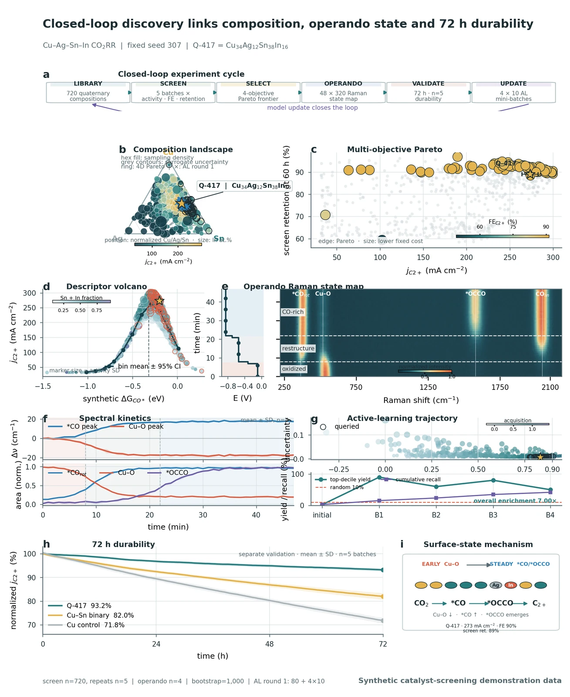
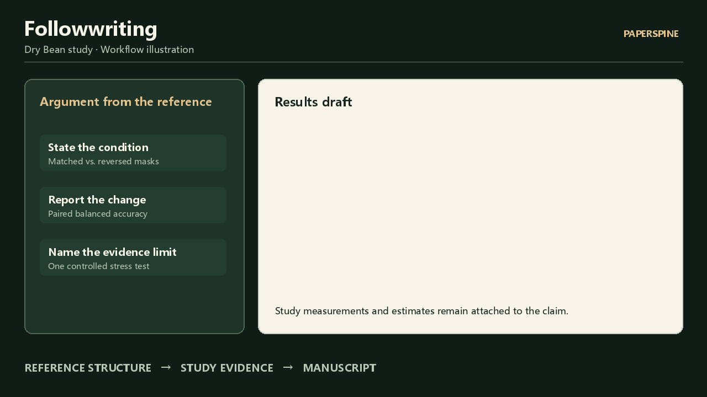
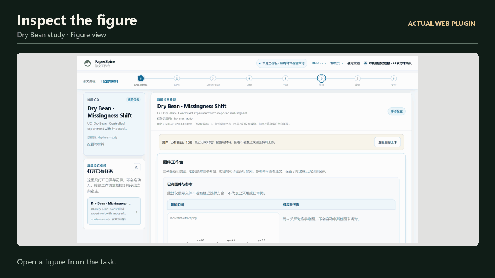
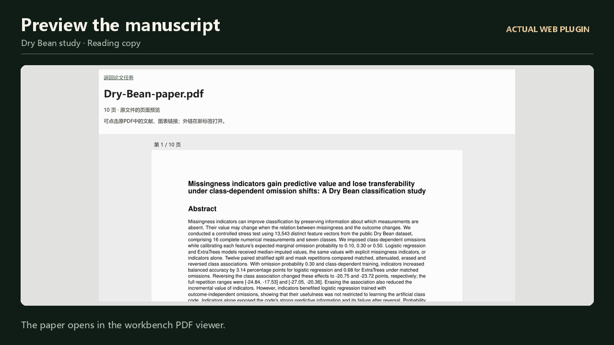
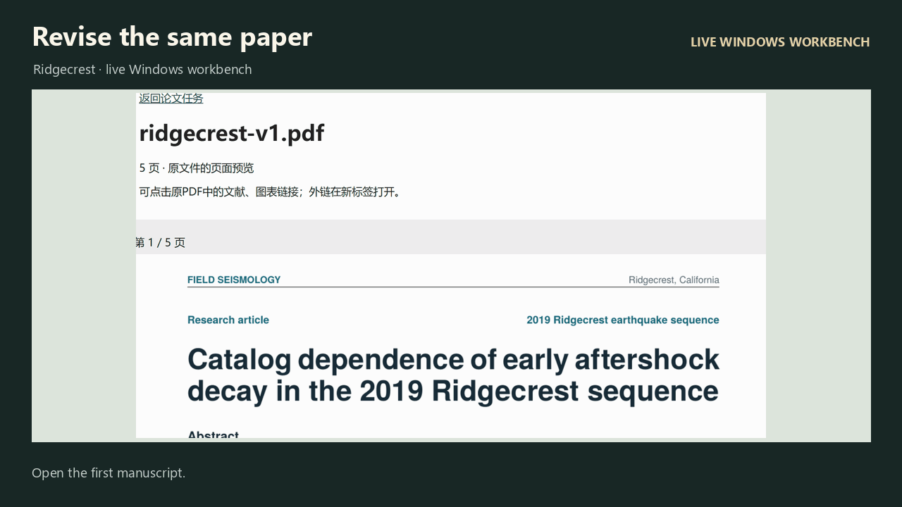

**English** · [中文](README.zh-CN.md)

<a href="https://wubing2023.github.io/PaperSpine/v6/"></a>

**Run experiments, make scientific figures, and deliver an editable paper with the evidence attached.** PaperSpine gives your research agent the methods to start with a question, a results folder, or a draft.

[**Get PaperSpine**](#ways-to-work) · [Field test](#edition-field-test) · [Research cases](#research-cases) · [Demos](#feature-demos) · [**Press kit**](#press-kit) · [Website](https://wubing2023.github.io/PaperSpine/v6/)

<a id="ways-to-work"></a>

## Three ways to work

| Edition | Start here | Deliverables |
| :--- | :--- | :--- |
| **Full Workflow Skill**<br>[Download ZIP](https://github.com/WUBING2023/PaperSpine/releases/download/v6.0.0-beta.2/paperspine-skill-6.0.0-beta.2.zip) | `$paper-spine`<br>Give it a question, data, or an existing draft in an agent chat. | Study notes, analysis, figures, and an editable manuscript for the agreed scope. |
| **Skills Pack**<br>[Download ZIP](https://github.com/WUBING2023/PaperSpine/releases/download/v6.0.0-beta.2/paperspine-skills-pack-6.0.0-beta.2.zip) | `$paper-spine` for the full workflow or `$paper-spine-followwriting` to revise a section. | The output you need at each stage, with the sources and files kept for the next stage. |
| **Web Plugin**<br>[Download ZIP](https://github.com/WUBING2023/PaperSpine/releases/download/v6.0.0-beta.2/paperspine-web-plugin-6.0.0-beta.2-windows-x64.zip) | `$paper-spine-web:paper-spine-web` in Codex on Windows x64. | The Skills Pack plus a local workbench for choices, figure zoom, manuscript preview, downloads, and revisions. |

<details>
<summary><strong>Five stage Skills with example prompts</strong></summary>

| Skill | What to ask for |
| --- | --- |
| `$paper-spine-study` | Design a paired test using this dataset and save the split-level results. |
| `$paper-spine-followwriting` | Use these reference papers to revise the Results argument. Keep my estimates and claim scope. |
| `$paper-spine-figures` | Make a vector figure from these analysis outputs and include the figure code. |
| `$paper-spine-review` | Check which claims the sources and figures support, then revise the weak ones. |
| `$paper-spine-deliver` | Export the editable manuscript, a reading copy, and the supporting artifacts. |

</details>

<a id="installation"></a>

## Installation and updates

Extract your chosen ZIP. Run its manager from the extracted folder, using the original ZIP and its SHA-256. Then open a fresh host chat.

```text
python -B edition_manager.py install "<original ZIP path>" --sha256 <SHA256>
```

The manager requires Python 3.12+. The Web archive includes Windows Python and requires the Codex CLI. Managed installations support automatic update checks, manual upgrades, rollback, and uninstall. Drafts and local tasks are retained.

[Install, update, or uninstall](INSTALL-V6.en.md) · [SHA-256 checksums](https://github.com/WUBING2023/PaperSpine/releases/download/v6.0.0-beta.2/checksums.sha256) · [V6 release](https://github.com/WUBING2023/PaperSpine/releases/tag/v6.0.0-beta.2)

<a id="edition-field-test"></a>

## One study, three workflows

Three Codex subagents installed the three released V6 editions and ran the same study. On 13,543 public Dry Bean records, training-fold standardization moved mean balanced accuracy from **71.62% to 93.46%** for a fixed 7-nearest-neighbor classifier across the same five folds.

| Full Workflow Skill | Skills Pack | Web Plugin |
| :--- | :--- | :--- |
| Produced a revised two-page manuscript, reproducible analysis, and editable figure. | Ran all five stages with real files and rebuilt the paper from the exported bundle. | Saved manuscript feedback, revised the same task, then downloaded the new Word and PDF files. |

[**Read the run notes**](paperspine5/core/07_发布页/v6/science/edition-field-test.md) · [Research paper and code](https://wubing2023.github.io/PaperSpine/v6/science/scaling-study-source.zip) · [Web revision PDF](paperspine5/core/07_发布页/v6/science/scaling-workbench.pdf) · [Editable Word](paperspine5/core/07_发布页/v6/science/scaling-workbench.docx)

<a id="research-cases"></a>

## Research cases

These are selected artifacts from documented, PaperSpine-assisted research runs. Open the manuscripts and figures to see the methods, results, and scope.

### Missingness shift · Dry Bean

The agent designed a controlled experiment on public seed measurements and compared matched and reversed missingness across two classifiers.

The run used 13,543 records after deduplication and scored 2,160 evaluation conditions. At 30% imposed missingness, adding logistic-regression indicators changed balanced accuracy by **+3.14 pp** under matched masks and **−20.75 pp** under reversal. The result concerns this controlled stress test.

<a href="paperspine5/core/07_发布页/v6/science/dry-bean-figure.svg"></a>

[Read the paper](paperspine5/core/07_发布页/v6/science/dry-bean-paper.pdf) · [Open the original vector](paperspine5/core/07_发布页/v6/science/dry-bean-figure.svg) · [Dataset source](https://doi.org/10.24432/C50S4B)

### Bootstrap feature aggregation

This study traced how a tie in feature selection altered nested model tuning even with an unchanged final feature subset.

One Digits split changed the tuned regularization from **C = 10 to C = 1** and **eight predicted labels**. The manuscript also compares three public datasets and one synthetic condition. This is an implementation diagnosis.

<a href="paperspine5/core/07_发布页/v6/science/feature-aggregation-figure.svg"></a>

[Read the paper](paperspine5/core/07_发布页/v6/science/feature-aggregation-paper.pdf) · [Open the original vector](paperspine5/core/07_发布页/v6/science/feature-aggregation-figure.svg) · [Case evidence](paperspine5/core/07_发布页/v6/science/case-notes.md)

### Editable figures for other fields

The figure gallery includes a **solid-state battery interface schematic** and a **closed-loop catalyst-screening visualization**. These are an illustrative mechanism and a synthetic data example.

<p><a href="https://wubing2023.github.io/PaperSpine/v6/#figures"></a></p>

[Full-resolution PNGs and SVGs in Figure Studies](https://wubing2023.github.io/PaperSpine/v5/en/figure-studies/)

<a id="paper-example"></a>
<a id="feature-demos"></a>

## Feature demos

<table><tr>
  <td width="50%"><a href="paperspine5/core/07_发布页/v6/science/followwriting-hd.gif"><picture>
    <source media="(prefers-reduced-motion: reduce)" srcset="paperspine5/core/07_发布页/v6/science/followwriting-hd-still.webp">
    
  </picture></a><br><strong>Followwriting</strong></td>
  <td width="50%"><a href="paperspine5/core/07_发布页/v6/science/figures-hd.gif"><picture>
    <source media="(prefers-reduced-motion: reduce)" srcset="paperspine5/core/07_发布页/v6/science/figures-hd-still.webp">
    
  </picture></a><br><strong>Figure review</strong></td>
</tr><tr>
  <td width="50%"><a href="paperspine5/core/07_发布页/v6/science/workbench-hd.gif"><picture>
    <source media="(prefers-reduced-motion: reduce)" srcset="paperspine5/core/07_发布页/v6/science/workbench-hd-still.webp">
    
  </picture></a><br><strong>Manuscript preview</strong></td>
  <td width="50%"><a href="paperspine5/core/07_发布页/v6/science/revision-hd.gif"><picture>
    <source media="(prefers-reduced-motion: reduce)" srcset="paperspine5/core/07_发布页/v6/science/revision-hd-still.webp">
    
  </picture></a><br><strong>Review and revise</strong></td>
</tr></table>

Followwriting illustrates how to use a reference’s structure while writing from the study’s own results. The other clips come from the released Windows workbench. [Watch a feedback-to-revision run](https://wubing2023.github.io/PaperSpine/v6/#revision) · [Full-size workbench screenshots](https://wubing2023.github.io/PaperSpine/v6/#examples)

<a id="press-kit"></a>

## Press kit

> PaperSpine is an open-source AI for Science workflow. It helps research agents run experiments, create scientific figures, and deliver editable papers. Choose a full workflow Skill, individual Skills, or a local workbench.

[**Download the press kit**](https://wubing2023.github.io/PaperSpine/v6/science/paperspine-v6-press-kit.zip) · [Bilingual intro and captions](paperspine5/core/07_发布页/v6/science/press-copy.md) · [Landscape cover](paperspine5/core/07_发布页/v6/science/press-cover.png) · [Portrait cover](paperspine5/core/07_发布页/v6/science/press-portrait.png) · [Spine transparent PNG](paperspine5/core/07_发布页/v6/science/spine.png)

## Development and community

[V6 sources](paperspine5/core/01_PaperSpine4/src/skill-editions/) · [Install manager](paperspine5/core/06_插件化/release/edition_manager.py) · [Website source](paperspine5/core/07_发布页/v6/) · [Report an issue](https://github.com/WUBING2023/PaperSpine/issues)

<details>
<summary>V5 documentation and source index</summary>

- Methods and working artifacts · [writing_rationale_matrix](src/skill/references/rewrite.md) · [citation_support_bank](src/skill/references/citation-support-bank.md) · [translation_package](src/skill/references/translation-package.md)
- Export and verification tools · [artifact_check.py](src/scripts/artifact_check.py) · [reference_inventory.py](src/scripts/reference_inventory.py) · [citation_bank_check.py](src/scripts/citation_bank_check.py) · [latex_guard.py](src/scripts/latex_guard.py) · [word_guard.py](src/scripts/word_guard.py)
- Legacy host projections · [Codex](dist/codex/skills/paper-spine/) · [Claude](dist/claude/skills/paper-spine/) · [OpenClaw](dist/openclaw/skills/paper-spine/) · [Claude command](dist/claude/commands/paperspine.md)
- V5 installers · [install.ps1](install.ps1) · [install.sh](install.sh)

[V5 archive](https://wubing2023.github.io/PaperSpine/v5/en/?legacy=1) · [日本語](README.ja.md) · [한국어](README.ko.md) · [Español](README.es.md) · [Français](README.fr.md) · [Deutsch](README.de.md) · [Русский](README.ru.md) · [Português](README.pt.md)

</details>

## License

[MIT](LICENSE) · [Instrument Serif](paperspine5/core/07_发布页/v6/fonts/instrument-OFL.txt) · [Noto Serif SC](paperspine5/core/07_发布页/v6/fonts/notoserifsc-OFL.txt)
