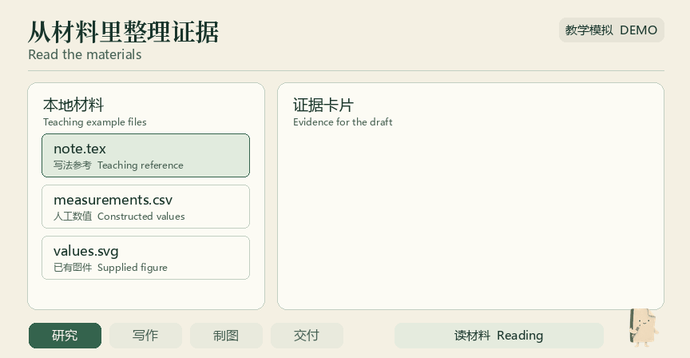
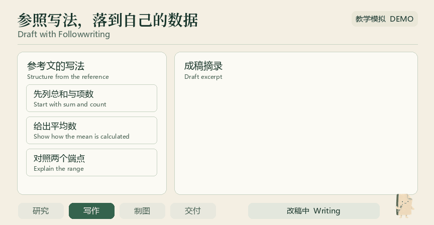
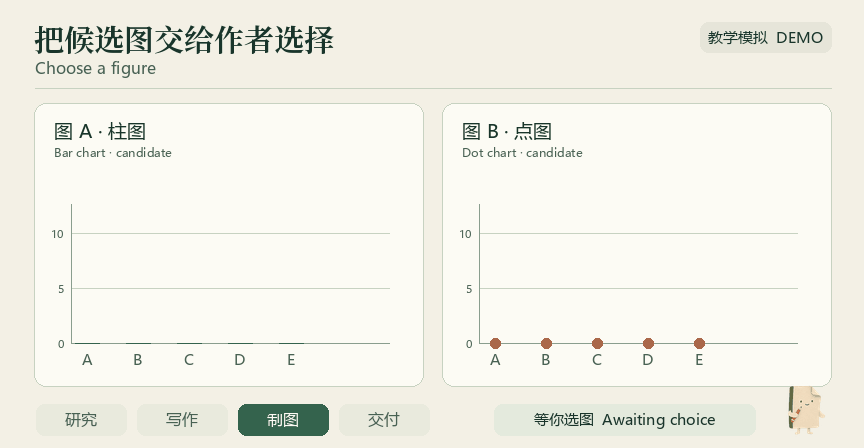
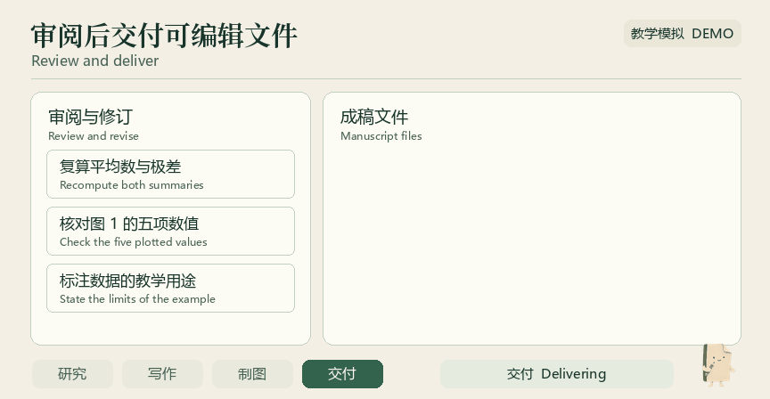
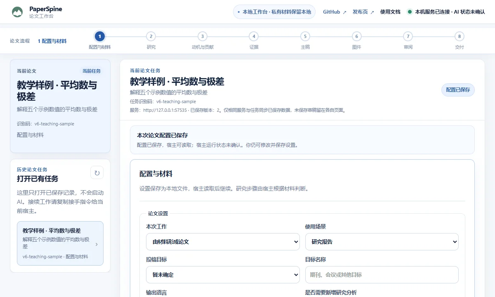

[中文](README.md) · [English](README.en.md)

<p align="center">
  <a href="https://wubing2023.github.io/PaperSpine/v6/"></a>
</p>

<p align="center">一套给科研工作用的 Skills。从研究问题、现有结果或初稿开始，在同一个对话里查阅文献、写作、制图和审阅。</p>

<p align="center">
  <b><a href="https://wubing2023.github.io/PaperSpine/v6/#download">官网下载</a></b> · <a href="https://github.com/WUBING2023/PaperSpine/releases/tag/v6.0.0-beta.2">GitHub Release</a> · <a href="INSTALL-V6.md">安装与卸载</a> · <a href="#paper-example">论文示例</a>
</p>

## 下载 PaperSpine V6

当前公测版为 `6.0.0-beta.2`。选择一种安装方式即可。

| 安装方式 | 适合谁 | 环境 | 直接下载 |
| --- | --- | --- | --- |
| **全流程 Skill** | 想用一个入口推进整篇论文 | 支持 Skill 的宿主 | [下载 ZIP](https://github.com/WUBING2023/PaperSpine/releases/download/v6.0.0-beta.2/paperspine-skill-6.0.0-beta.2.zip) |
| **Skills 包** | 经常做科研，希望独立调用写作、制图、审阅等阶段 | 支持 Skill 的宿主 | [下载 ZIP](https://github.com/WUBING2023/PaperSpine/releases/download/v6.0.0-beta.2/paperspine-skills-pack-6.0.0-beta.2.zip) |
| **Web 插件包** | 想用本地工作台看设置、选图、预览和返修 | Windows x64 · Codex | [下载 ZIP](https://github.com/WUBING2023/PaperSpine/releases/download/v6.0.0-beta.2/paperspine-web-plugin-6.0.0-beta.2-windows-x64.zip) |

发行包和 SHA-256 校验清单可以在同一 Release 获取。手动复制 Skills 和受管安装的步骤见安装说明。 [阅读安装说明](INSTALL-V6.md) · [下载校验清单](https://github.com/WUBING2023/PaperSpine/releases/download/v6.0.0-beta.2/checksums.sha256)

## 入门

1. 下载一个 ZIP 和校验清单，解压 ZIP。
2. 在解压目录运行安装命令，把 `<ZIP 路径>` 和 `<SHA256>` 换成你下载的文件路径和对应校验值。
3. 打开一个新对话，给 `$paper-spine` 一个题目、结果目录或已有稿件。

```text
python -B edition_manager.py install "<ZIP 路径>" --sha256 <SHA256>
```

管理器需要 Python 3.12 或以上。Web 包带 Windows Python，并需要 Codex CLI。

可以这样发第一条消息

```text
$paper-spine 用 ./results 和 ./draft.md 整理成一篇论文。先确认主要结论和缺失证据，保留已有结果与图件。
```

装了 Skills 包，也可以从手头这一段开始。

| Skill | 用途 |
| --- | --- |
| `$paper-spine-study` | **研究** · 梳理研究问题、材料与可验证的证据。 |
| `$paper-spine-followwriting` | **Followwriting 写作** · 沿参考论文学习论证和段落安排，改写当前稿件。 |
| `$paper-spine-figures` | **科研制图** · 对照图件与论文主张，准备和比较候选图。 |
| `$paper-spine-review` | **审阅返修** · 核对证据、图和引用，给出可定位的修订。 |
| `$paper-spine-deliver` | **交付** · 整理用户指定的可编辑文件和阅读版。 |

Web 包安装完成后，在 Codex 调用 `$paper-spine-web:paper-spine-web` 打开本地工作台。

<a id="paper-example"></a>

## 从材料到成稿

四段动图沿用同一份由人工构造数值组成的教学材料，模拟论文工作流。下面的成稿预览和工作台截图来自实际本地试用。

<p align="center"></p>

**认识页页。** 一张拿着铅笔的折角纸，是 PaperSpine 的演示角色。在动图里，它提示 Agent 正在读材料、改稿、等你选图或交付。

### 读材料，列证据

从已有资料提取五项数值，再算平均数和极差。

<picture>
  <source media="(prefers-reduced-motion: reduce)" srcset="paperspine5/core/07_发布页/v6/readme/research-still.webp">
  
</picture>

### 用 Followwriting 改一段

参考文提示先给总和与项数，再解释两端的差。正文用本例的数值填实论证。

<picture>
  <source media="(prefers-reduced-motion: reduce)" srcset="paperspine5/core/07_发布页/v6/readme/followwriting-still.webp">
  
</picture>

### 比较两张图，由作者确认

用同一组数值比较柱图和点图。示例里作者选择柱图。

<picture>
  <source media="(prefers-reduced-motion: reduce)" srcset="paperspine5/core/07_发布页/v6/readme/figure-choice-still.webp">
  
</picture>

### 审阅、返修，再交付

复算两个统计量，核对图件，说明教学数据的适用范围，交付正文、PDF 和可编辑图源。

<picture>
  <source media="(prefers-reduced-motion: reduce)" srcset="paperspine5/core/07_发布页/v6/readme/review-delivery-still.webp">
  
</picture>

[打开完整成稿预览](paperspine5/core/07_发布页/v6/draft-example.webp)

<details>
<summary>可选的本地工作台</summary>

在同一个论文任务下保存设置、选择图件、预览稿件或提交反馈。



</details>

## 更新与卸载

受管安装按所选形态整包更新，运行 Skill 时会间隔检查 V6 频道。管理器会校验新包并保留一个可回退版本。卸载保留稿件、原始资料和本地工作台任务。

| 管理器命令 | 作用 |
| --- | --- |
| `check` / `update` | 检查或立即应用更新。 |
| `auto-update off` / `auto-update on` | 关闭或者恢复自动检查。 |
| `rollback` | 回到保留的上一版本。 |
| `uninstall` | 移除当前受管安装。 |

[查看所有命令与参数](INSTALL-V6.md)

## 常见问题

<details>
<summary>需要开网页吗？</summary>

两种 Skill 形态直接在宿主对话里使用。Web 工作台随 Windows x64 Codex 的 Web 插件包提供。

</details>

<details>
<summary>能从手头的结果或初稿开始吗？</summary>

可以。把结果、图源、稿件和写作要求交给 Agent，可以从适用阶段开始。如果只想改稿，可以明确要求沿用现有实验。

</details>

<details>
<summary>V5 的论文怎么办？</summary>

V5 可通过自己的旧入口继续使用。V6 Web 默认使用独立任务目录，旧 V5 profile 的自动迁移尚未验证。也可以把旧项目的论文文件交给 V6 Skill 接着写。

</details>

<details>
<summary>材料会在哪里处理？</summary>

本地工作台把任务保存到本机。模型能收到哪些内容取决于宿主和配置的模型服务。敏感资料请先核对宿主的权限、数据设置和机构要求。论文结论、引文和作者信息需要研究者核实。

</details>

## 开发与贡献

阶段 Skill、写作方法、发行管理器和官网的实现入口如下。构建 V6 发行包可从现有 GitHub Actions 工作流开始。

- [阶段 Skills 源码](paperspine5/core/01_PaperSpine4/src/skill-editions/)
- [科研与写作方法](paperspine5/core/01_PaperSpine4/src/skill/references/)
- [安装与更新管理器](paperspine5/core/06_插件化/release/edition_manager.py)
- [V6 网站与构建器](paperspine5/core/07_发布页/v6/)
- [发行构建工作流](.github/workflows/build-v6-release.yml)

<details>
<summary>源码导航与旧版入口</summary>

- 方法工作件。[writing_rationale_matrix](src/skill/references/rewrite.md) · [citation_support_bank](src/skill/references/citation-support-bank.md) · [translation_package](src/skill/references/translation-package.md)
- 导出与检查脚本。[artifact_check.py](src/scripts/artifact_check.py) · [reference_inventory.py](src/scripts/reference_inventory.py) · [citation_bank_check.py](src/scripts/citation_bank_check.py) · [latex_guard.py](src/scripts/latex_guard.py) · [word_guard.py](src/scripts/word_guard.py)
- 旧版宿主投影。[Codex](dist/codex/skills/paper-spine/) · [Claude](dist/claude/skills/paper-spine/) · [OpenClaw](dist/openclaw/skills/paper-spine/) · [Claude 命令](dist/claude/commands/paperspine.md)
- V5 安装器。[install.ps1](install.ps1) · [install.sh](install.sh)

</details>

欢迎在 GitHub Issues 提交脱敏后的复现步骤、所用形态和版本。公开社区星图显示 GitHub Stargazer 自报信息。 [问题反馈](https://github.com/WUBING2023/PaperSpine/issues) · [社区星图](https://wubing2023.github.io/PaperSpine/v5/community/)

[V5 官网与文档存档](https://wubing2023.github.io/PaperSpine/v5/?legacy=1)

<details>
<summary>V5 其他语言说明</summary>

[日本語](README.ja.md) · [한국어](README.ko.md) · [Español](README.es.md) · [Français](README.fr.md) · [Deutsch](README.de.md) · [Русский](README.ru.md) · [Português](README.pt.md)

</details>

## 许可证

PaperSpine 代码按 MIT 许可发布。字体许可随官网源文件提供。 [MIT](LICENSE) · [Instrument Serif](paperspine5/core/07_发布页/v6/fonts/instrument-OFL.txt) · [Noto Serif SC](paperspine5/core/07_发布页/v6/fonts/notoserifsc-OFL.txt)
