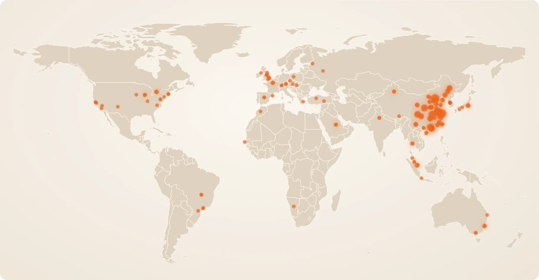

<h1 align="center">
  
</h1>

<p align="center">
  <a href="https://github.com/WUBING2023/PaperSpine/releases/download/v6.0.0-beta.2/paperspine-skill-6.0.0-beta.2.zip"><picture>
    <source media="(prefers-reduced-motion: reduce)" srcset="https://wubing2023.github.io/PaperSpine/v6/activity-still.svg">
    
  </picture></a>
</p>

<p align="center"><strong>Начните с исследовательского вопроса, данных или черновика. Получите редактируемую статью с проверяемыми доказательствами.</strong></p>

<p align="center">
  <a href="#install-with-ai"><strong>Быстрый старт</strong></a> · <a href="#quick-demo">Демо</a> · <a href="#research-cases">Примеры исследований</a><br>
  <small><a href="https://wubing2023.github.io/PaperSpine/v6/ru/">Сайт</a> · <a href="https://wubing2023.github.io/PaperSpine/v6/ru/install.html">Руководство по установке</a> · <a href="#ways-to-work">Сравнить варианты</a> · <a href="https://wubing2023.github.io/PaperSpine/?lang=ru">Атлас сообщества</a></small>
</p>

<p align="center">
  <a href="https://github.com/WUBING2023/PaperSpine/releases/tag/v6.0.0-beta.2"></a>
  <a href="https://github.com/WUBING2023/PaperSpine/stargazers"></a>
  <a href="LICENSE"></a>
  <a href="https://github.com/WUBING2023/PaperSpine/actions/workflows/validate.yml"></a>
  <a href="https://wubing2023.github.io/PaperSpine/contributors/ru.html"></a>
  <a href="https://github.com/WUBING2023/PaperSpine/issues?q=is%3Aissue+is%3Aclosed"></a>
  <a href="https://github.com/WUBING2023/PaperSpine/commits/main/"></a>
</p>

<p align="center">
  <sub>V6</sub>
  <a href="README.md"></a>
  <a href="README.zh-CN.md"></a>
  <a href="README.ja.md"></a>
  <a href="README.ko.md"></a>
  <a href="README.es.md"></a>
  <a href="README.fr.md"></a>
  <a href="README.de.md"></a>
  <a href="README.pt.md"></a>
  <a href="README.ru.md"></a>
</p>

<a id="quick-demo"></a>

## Писать статью как исследователь

<p align="center">
  <picture>
    <source media="(prefers-reduced-motion: reduce)" srcset="paperspine5/core/07_发布页/v6/readme/rounded/paperspine_codex_demo_v3_15s-still.webp">
    
  </picture>
</p>

<p align="center"><small>Followwriting · Проверка иллюстраций · Предпросмотр рукописи · Правки</small></p>

<a id="workflow"></a>

## Как работает PaperSpine

Используйте статьи-ориентиры как модели изложения, а выводы подкрепляйте доказательствами собственного исследования.

<p align="center">
  <picture>
    <source media="(prefers-reduced-motion: reduce)" srcset="paperspine5/core/07_发布页/v6/readme/rounded/paperspine-workflow-8s-zh-still.webp">
    
  </picture>
</p>

<p align="center"><small>Собрать доказательства → Написать по ориентирам → Создать редактируемые рисунки → Проверить и экспортировать</small></p>

<a id="install-with-ai"></a>

## Установка с помощью ИИ

Вставьте этот запрос в чат с агентом, которым пользуетесь для исследований.

```text
Установи PaperSpine в этой среде. Сначала прочитай официальное руководство.
https://wubing2023.github.io/PaperSpine/v6/llms.txt

Выбери вариант, подходящий для моей задачи и окружения. Проверь ZIP по SHA-256. После установки подтверди версию и объясни, как вызвать навык.
```

[Инструкция по установке для агента](https://wubing2023.github.io/PaperSpine/v6/llms.txt) · [Манифест выпуска (JSON)](https://wubing2023.github.io/PaperSpine/v6/channel.json)

<a id="ways-to-work"></a>

## Три режима работы

<a id="start-with-skill"></a>

### Быстрый старт · навык полного цикла

Вызовите `$paper-spine` в чате с агентом вместе с вопросом, данными или черновиком. Получите заметки, анализ, иллюстрации и редактируемую рукопись в согласованных пределах.

[**Скачать ZIP**](https://github.com/WUBING2023/PaperSpine/releases/download/v6.0.0-beta.2/paperspine-skill-6.0.0-beta.2.zip) · 

### Отдельные задачи · набор навыков

Используйте `$paper-spine` для полного цикла или вызовите нужный этап напрямую. Например, `$paper-spine-followwriting` помогает переработать раздел по вашим данным и статьям-ориентирам.

[**Скачать ZIP**](https://github.com/WUBING2023/PaperSpine/releases/download/v6.0.0-beta.2/paperspine-skills-pack-6.0.0-beta.2.zip) · 

### Рабочая среда · веб-плагин

Подключите локальную рабочую среду для проверки рисунков, просмотра черновиков и отправки замечаний из браузера. Она включает набор навыков и запускается через `$paper-spine-web:paper-spine-web` в Codex под Windows x64.

[**Скачать ZIP**](https://github.com/WUBING2023/PaperSpine/releases/download/v6.0.0-beta.2/paperspine-web-plugin-6.0.0-beta.2-windows-x64.zip) · 

<details>
<summary><strong>Пять навыков по этапам с примерами запросов</strong></summary>

| Навык | Что поручить |
| --- | --- |
| `$paper-spine-study` | Спланируй парный тест для этих данных и сохрани результаты каждого разбиения. |
| `$paper-spine-followwriting` | Переработай аргументацию раздела результатов с помощью этих статей. Сохрани мои оценки и границы выводов. |
| `$paper-spine-figures` | Построй векторный рисунок по этим результатам и приложи код его создания. |
| `$paper-spine-review` | Проверь, какие утверждения подтверждаются источниками и рисунками, и переработай слабо обоснованные. |
| `$paper-spine-deliver` | Экспортируй редактируемую рукопись, копию для чтения и сопроводительные материалы. |

</details>

<a id="installation"></a>

## Установка и обновления

Сверьте ZIP со списком контрольных сумм. Распакуйте его и запустите менеджер из извлечённого каталога с путём к исходному ZIP и полным SHA-256. Затем откройте новый чат.

```text
python -B edition_manager.py install "<original ZIP path>" --sha256 <SHA256>
```

Менеджер требует Python 3.12 или новее. Веб-архив содержит Python для Windows и требует CLI Codex. Управляемые установки поддерживают автоматическую проверку обновлений, ручное обновление, откат и удаление. Черновики и локальные задачи сохраняются.

[Установка, обновление и удаление](https://wubing2023.github.io/PaperSpine/v6/ru/install.html) · [Контрольные суммы SHA-256](https://github.com/WUBING2023/PaperSpine/releases/download/v6.0.0-beta.2/checksums.sha256) · [Выпуск V6](https://github.com/WUBING2023/PaperSpine/releases/tag/v6.0.0-beta.2)

## Как PaperSpine связывает доказательства со статьёй

- **Определяйте рамки по имеющимся материалам.** Исследовательский вопрос может потребовать открытых данных или нового анализа. С готовыми результатами можно перейти к рисунку, аргументации или рецензированию. Агент переносит файлы и решения между этапами.
- **Отслеживайте отдельно текстовые решения и научные доказательства.** Followwriting показывает фрагменты источников, повлиявшие на структуру и формулировки. Выводы опираются на доказательства исследования. Сохраняйте анализ, исходники рисунков и цитаты для проверки.
- **Ведите рецензирование в той же работе.** Сохраните выбранный рисунок и замечания вместе с редактируемой рукописью. При правках можно проверить доказательства, обновить текст и затронутые рисунки, а также записать изменения.

Исследование LIGO показывает этот процесс. Проследите от статьи к совмещённым сигналам и девяти проверкам предобработки, подтверждающим порядок прихода. [Доказательства и исходники LIGO](https://wubing2023.github.io/PaperSpine/v6/ru/#gravitational-waves)

<a id="research-cases"></a>

## Усиление атлантических циклонов при сопоставимых начальных условиях

В исследовании с самостоятельным навыком PaperSpine сравнил 42 сезона траекторий NOAA. В 6 017 сопоставимых 24-часовых окнах разница при 30 узлах составила +0,81 п. п. (95%-й интервал по бутстрэпу сезонов от −1,69 до +3,43). При 25 узлах точечная оценка меняет знак. Шесть панелей прослеживают 484 траектории по 24 часа, разбивают прирост на непересекающиеся диапазоны и показывают разницу и неопределённость для девяти порогов.

<a href="https://wubing2023.github.io/PaperSpine/v6/ru/#showcase"></a>

[Читать статью](https://wubing2023.github.io/PaperSpine/v6/science/research/atlantic-ri/paper.pdf) · [Основной рисунок SVG](paperspine5/core/07_发布页/v6/science/research/atlantic-ri/figure.svg) · [Чувствительность SVG](paperspine5/core/07_发布页/v6/science/research/atlantic-ri/checks.svg) · [Редактируемая статья и код анализа](https://wubing2023.github.io/PaperSpine/v6/science/research/atlantic-ri/source.zip)

Переключайте исследования, титульную страницу, результаты, основной рисунок и проверку чувствительности. [Открыть галерею исследований](https://wubing2023.github.io/PaperSpine/v6/ru/?v=research-gallery#showcase)

<a id="edition-field-test"></a>

## Три статьи, три режима

GPT‑6.1 Sol использовал все три варианта PaperSpine для каждого исследования. [Девять документированных запусков](paperspine5/core/07_发布页/v6/science/research/README.md#how-the-runs-were-conducted) включают статьи, открытые данные, исходные рисунки, воспроизводимый код и историю правок.

[Переключить страницы, рисунки и проверки чувствительности](https://wubing2023.github.io/PaperSpine/v6/ru/#showcase)

### Два слияния чёрных дыр с миллисекундной точностью

В двух открытых событиях LIGO детектор в Хэнфорде зарегистрировал сигнал на 7,36 и 7,75 мс позже Ливингстона. Знак задержки сохранился при всех девяти вариантах предобработки.

<a href="paperspine5/core/07_发布页/v6/science/research/gravitational-waves/figure.svg"></a>

[Читать статью](https://wubing2023.github.io/PaperSpine/v6/science/research/gravitational-waves/paper.pdf) · [Векторный рисунок высокого разрешения](paperspine5/core/07_发布页/v6/science/research/gravitational-waves/figure.svg) · [Исходники статьи и код](https://wubing2023.github.io/PaperSpine/v6/science/research/gravitational-waves/source.zip) · [Данные](https://doi.org/10.7935/82H3-HH23)

### Затухание афтершоков зависит от каталога

При магнитуде M ≥ 1,5 и через 1–72 часа после события Mw 7,1 оценка показателя затухания равна 0,55 в ComCat и 0,48 в каталоге Шелли с уточнёнными координатами.

<a href="paperspine5/core/07_发布页/v6/science/research/ridgecrest/figure.svg"></a>

[Читать статью](https://wubing2023.github.io/PaperSpine/v6/science/research/ridgecrest/paper.pdf) · [Векторный рисунок высокого разрешения](paperspine5/core/07_发布页/v6/science/research/ridgecrest/figure.svg) · [Исходники статьи и код](https://wubing2023.github.io/PaperSpine/v6/science/research/ridgecrest/source.zip) · [Данные](https://doi.org/10.5066/P9JN6H0N)

### Два разных региональных следа дыма в июне

Относительно медианы 20–22 июня для каждой станции разница отклонений PM₂.₅ между Атлантикой и Великими озёрами сменила знак: с +74,1 мкг/м³ 6–8 июня до −69,1 мкг/м³ 27–29 июня.

<a href="paperspine5/core/07_发布页/v6/science/research/smoke/figure.svg"></a>

[Читать статью](https://wubing2023.github.io/PaperSpine/v6/science/research/smoke/paper.pdf) · [Векторный рисунок высокого разрешения](paperspine5/core/07_发布页/v6/science/research/smoke/figure.svg) · [Исходники статьи и код](https://wubing2023.github.io/PaperSpine/v6/science/research/smoke/source.zip) · [Данные](https://aqs.epa.gov/aqsweb/airdata/download_files.html)

[Записи о трёх режимах](paperspine5/core/07_发布页/v6/science/research/README.md) · [Проверка работы раннего варианта](paperspine5/core/07_发布页/v6/science/edition-field-test.md)

<a id="paper-example"></a>
<a id="feature-demos"></a>

## Демонстрации функций

<table><tr>
  <td width="50%"><a href="paperspine5/core/07_发布页/v6/science/followwriting-hd.gif"><picture>
    <source media="(prefers-reduced-motion: reduce)" srcset="paperspine5/core/07_发布页/v6/readme/rounded/followwriting-hd-still.webp">
    
  </picture></a><br><strong>Followwriting</strong></td>
  <td width="50%"><a href="paperspine5/core/07_发布页/v6/science/figures-hd.gif"><picture>
    <source media="(prefers-reduced-motion: reduce)" srcset="paperspine5/core/07_发布页/v6/readme/rounded/figures-hd-still.webp">
    
  </picture></a><br><strong>Проверка рисунков</strong></td>
</tr><tr>
  <td width="50%"><a href="paperspine5/core/07_发布页/v6/science/workbench-hd.gif"><picture>
    <source media="(prefers-reduced-motion: reduce)" srcset="paperspine5/core/07_发布页/v6/readme/rounded/workbench-hd-still.webp">
    
  </picture></a><br><strong>Предпросмотр рукописи</strong></td>
  <td width="50%"><a href="paperspine5/core/07_发布页/v6/science/revision-hd.gif"><picture>
    <source media="(prefers-reduced-motion: reduce)" srcset="paperspine5/core/07_发布页/v6/readme/rounded/revision-hd-still.webp">
    
  </picture></a><br><strong>Рецензирование и правки</strong></td>
</tr></table>

Followwriting показывает, как использовать структуру статьи-ориентира при изложении собственных результатов. Остальные ролики записаны в выпущенной рабочей среде Windows. [Посмотреть путь от замечания к правкам](https://wubing2023.github.io/PaperSpine/v6/ru/#revision) · [Снимки рабочей среды в полном размере](https://wubing2023.github.io/PaperSpine/v6/ru/#examples)

## Разработка и сообщество

<a href="https://wubing2023.github.io/PaperSpine/?lang=ru"></a>

[Кто участвовал в каждом обновлении V6](https://wubing2023.github.io/PaperSpine/contributors/ru.html#v6-contributions) · [Открыть атлас звёзд](https://wubing2023.github.io/PaperSpine/?lang=ru) · [Данные атласа (JSON)](https://wubing2023.github.io/PaperSpine/api/v1/atlas.json)

[Официальный сайт](https://wubing2023.github.io/PaperSpine/v6/ru/) · [Исходники V6](paperspine5/core/01_PaperSpine4/src/skill-editions/) · [Менеджер установки](paperspine5/core/06_插件化/release/edition_manager.py) · [Исходники сайта](paperspine5/core/07_发布页/v6/) · [Сообщить о проблеме](https://github.com/WUBING2023/PaperSpine/issues) · <a id="press-kit"></a>[Материалы проекта](https://wubing2023.github.io/PaperSpine/v6/science/paperspine-v6-press-kit.zip)

<details>
<summary>Документация и исходники V5</summary>

- Методы и рабочие материалы · [writing_rationale_matrix](src/skill/references/rewrite.md) · [citation_support_bank](src/skill/references/citation-support-bank.md) · [translation_package](src/skill/references/translation-package.md)
- Инструменты экспорта и проверки · [artifact_check.py](src/scripts/artifact_check.py) · [reference_inventory.py](src/scripts/reference_inventory.py) · [citation_bank_check.py](src/scripts/citation_bank_check.py) · [latex_guard.py](src/scripts/latex_guard.py) · [word_guard.py](src/scripts/word_guard.py)
- Прежние варианты для сред · [Codex](dist/codex/skills/paper-spine/) · [Claude](dist/claude/skills/paper-spine/) · [OpenClaw](dist/openclaw/skills/paper-spine/) · [Команда Claude](dist/claude/commands/paperspine.md)
- Установщики V5 · [install.ps1](install.ps1) · [install.sh](install.sh)

[Архив V5](https://wubing2023.github.io/PaperSpine/v5/en/?legacy=1)

</details>

## Лицензия

[MIT](LICENSE) · [Instrument Serif](paperspine5/core/07_发布页/v6/fonts/instrument-OFL.txt) · [Noto Serif SC](paperspine5/core/07_发布页/v6/fonts/notoserifsc-OFL.txt)
