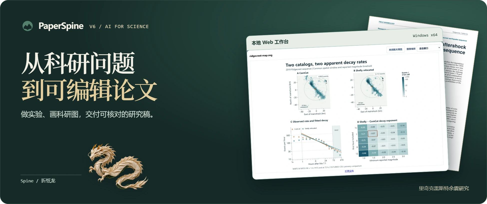
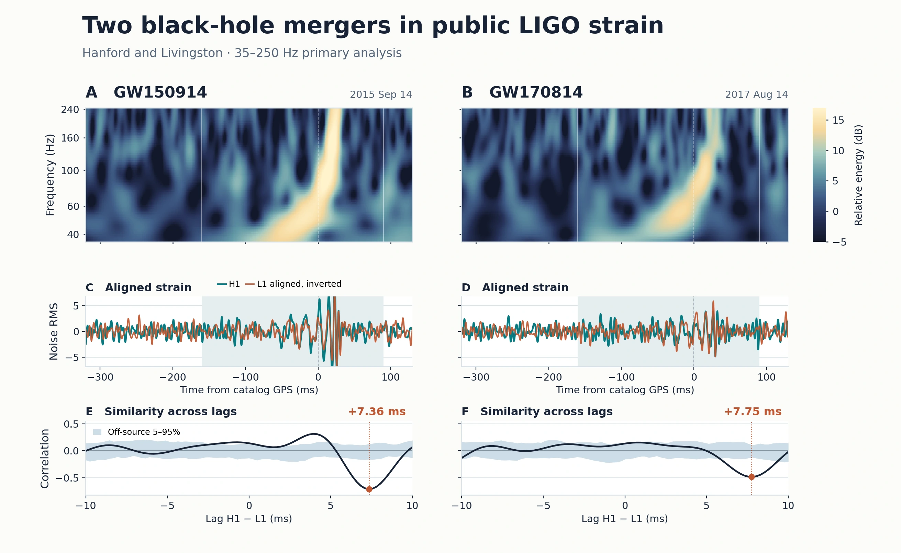
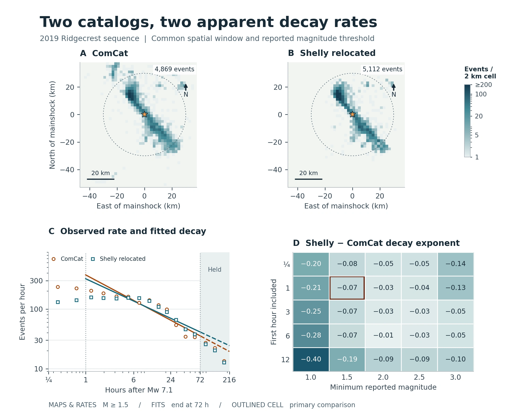
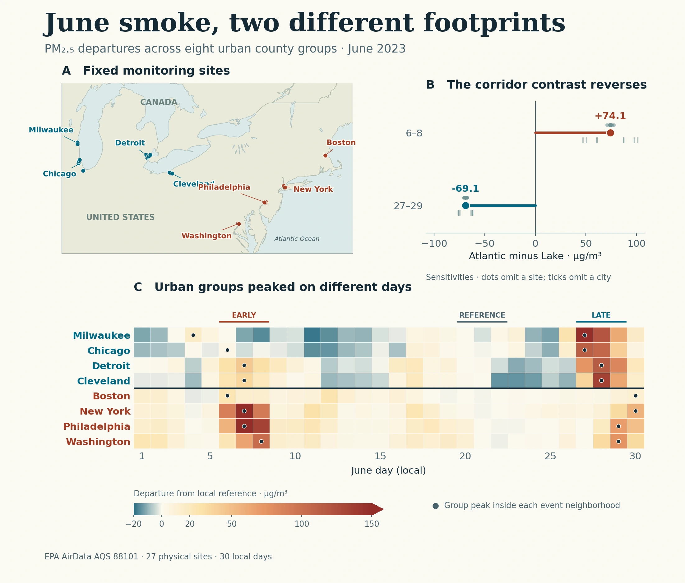
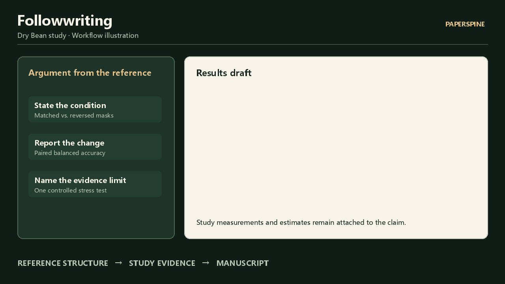
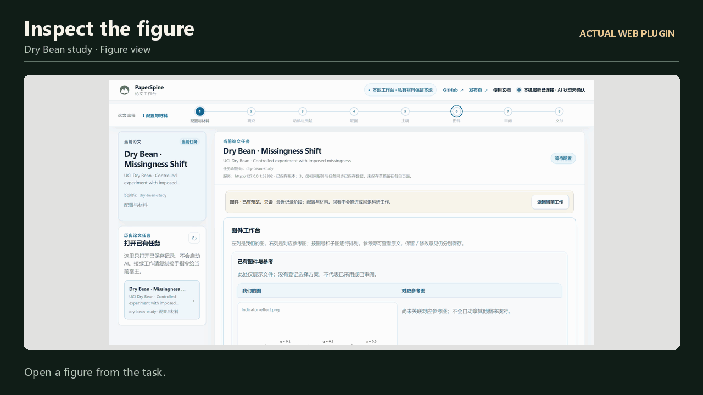
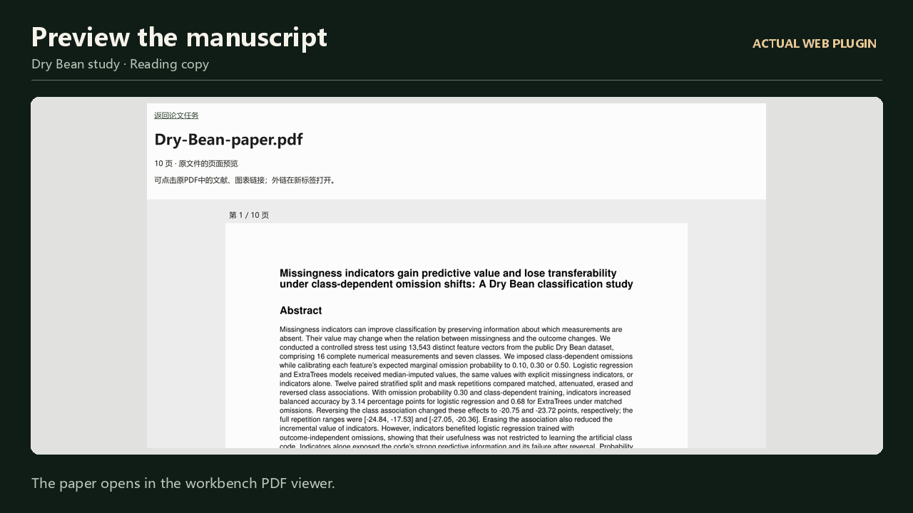
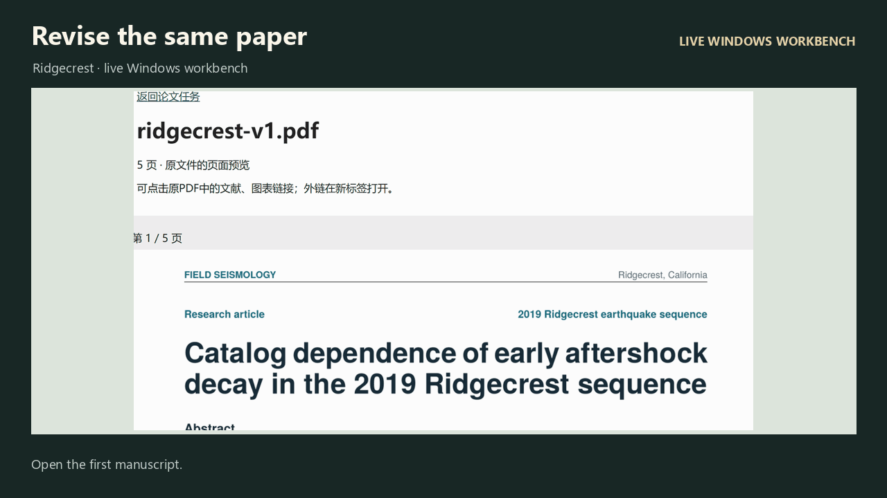

<div align="center">

[English](README.md) · **简体中文**

</div>

<p align="center">
  <a href="https://wubing2023.github.io/PaperSpine/v6/zh/"></a>
</p>

<p align="center">
  <strong>给科研 Agent 一个问题、一份数据或一篇初稿。</strong><br>
  从实验分析和图件审查，到交付一篇能编辑、能核对证据的论文。
</p>

<p align="center">
  <a href="https://github.com/WUBING2023/PaperSpine/releases/tag/v6.0.0-beta.2"></a>
  <a href="LICENSE"></a>
  <a href="https://wubing2023.github.io/PaperSpine/v6/zh/#edition-web"></a>
  <a href="https://github.com/WUBING2023/PaperSpine/issues"></a>
</p>

<p align="center">
  <a href="https://github.com/WUBING2023/PaperSpine/stargazers"><strong>6,000+ GitHub 星标</strong></a> ·
  <a href="#research-cases"><strong>3 篇公开数据研究稿</strong></a> ·
  <a href="paperspine5/core/07_发布页/v6/science/research/README.md#how-the-runs-were-conducted"><strong>9 次版本试跑</strong></a>
</p>

<p align="center">
  <a href="#ways-to-work"><strong>选择下载</strong></a> ·
  <a href="#feature-demos">功能动图</a> ·
  <a href="#press-kit">媒体素材</a> ·
  <a href="https://wubing2023.github.io/PaperSpine/v6/zh/">中文官网</a> ·
  <a href="https://wubing2023.github.io/PaperSpine/zh.html">社区星图</a> ·
  <a href="https://wubing2023.github.io/PaperSpine/contributors/zh.html">贡献者</a>
</p>

<a id="ways-to-work"></a>

## 三种使用方式

### 新手上手 · 全流程 Skill

在宿主对话里调用 `$paper-spine`，交给它题目、数据或初稿。按约定范围交付研究记录、分析、科研图和可编辑稿件。

[**下载 ZIP**](https://github.com/WUBING2023/PaperSpine/releases/download/v6.0.0-beta.2/paperspine-skill-6.0.0-beta.2.zip) · 

### 科研专家 · Skills 包

用 `$paper-spine` 跑全流程，也可以单独调用各个阶段。例如用 `$paper-spine-followwriting`，参照原论文的论证方式，用自己的实验结果改写一个章节。

[**下载 ZIP**](https://github.com/WUBING2023/PaperSpine/releases/download/v6.0.0-beta.2/paperspine-skills-pack-6.0.0-beta.2.zip) · 

### 满血插件 · 本地 Web 工作台

在 Windows x64 的 Codex 里调用 `$paper-spine-web:paper-spine-web`。包含整套 Skills，支持在本地工作台放大图件、预览论文、提交返修意见和下载成稿。

[**下载 ZIP**](https://github.com/WUBING2023/PaperSpine/releases/download/v6.0.0-beta.2/paperspine-web-plugin-6.0.0-beta.2-windows-x64.zip) · 

<details>
<summary><strong>五个阶段 Skill 和可以照着写的指令</strong></summary>

| Skill | 可以这样提需求 |
| --- | --- |
| `$paper-spine-study` | 用这份数据设计配对实验，保存每个划分的结果。 |
| `$paper-spine-followwriting` | 参考这两篇源论文调整 Results 的论证，保留我的估计值和结论范围。 |
| `$paper-spine-figures` | 用分析结果画矢量图，附上生成代码。 |
| `$paper-spine-review` | 核对证据能支撑哪些结论，指出薄弱处并修订。 |
| `$paper-spine-deliver` | 交付可编辑稿、阅读稿和支撑材料。 |

</details>

<a id="installation"></a>

## 安装、更新和卸载

解压选好的 ZIP，在解压目录运行随包附带的管理器。参数使用原 ZIP 路径及校验表里的 SHA-256。装完后打开新的宿主对话。

```text
python -B edition_manager.py install "<原 ZIP 路径>" --sha256 <SHA256>
```

管理器需要 Python 3.12 或更新版。Web 包含 Windows Python，还需要 Codex CLI。支持自动检查更新、手动升级、回退和卸载，保留论文、数据和本地任务。

[安装、更新及卸载说明](INSTALL-V6.md) · [SHA-256 校验文件](https://github.com/WUBING2023/PaperSpine/releases/download/v6.0.0-beta.2/checksums.sha256) · [V6 Release](https://github.com/WUBING2023/PaperSpine/releases/tag/v6.0.0-beta.2)

<a id="edition-field-test"></a>
<a id="research-cases"></a>

## 三篇研究，三种模式

以 GPT‑6.1 Sol 在三篇论文中分别走过全流程 Skill、阶段 Skills 与本地 Web 工作台。图件取自各自论文，附公开数据、可复算代码与同稿返修记录。

### 两次黑洞并合的毫秒级时延

两次公开 LIGO 事件中，汉福德相对利文斯顿分别滞后 7.36 和 7.75 毫秒。九种预处理设定下，时延方向一致。

<a href="paperspine5/core/07_发布页/v6/science/research/gravitational-waves/figure.svg"></a>

[读论文](https://wubing2023.github.io/PaperSpine/v6/science/research/gravitational-waves/paper.pdf) · [高清矢量图](paperspine5/core/07_发布页/v6/science/research/gravitational-waves/figure.svg) · [源稿与代码](https://wubing2023.github.io/PaperSpine/v6/science/research/gravitational-waves/source.zip) · [数据](https://doi.org/10.7935/82H3-HH23)

### 余震衰减估计随目录而变

在 Mw 7.1 主震后 1–72 小时、报告震级 ≥1.5 的相同口径下，ComCat 和 Shelly 重定位目录的拟合衰减指数分别为 0.55 与 0.48。

<a href="paperspine5/core/07_发布页/v6/science/research/ridgecrest/figure.svg"></a>

[读论文](https://wubing2023.github.io/PaperSpine/v6/science/research/ridgecrest/paper.pdf) · [高清矢量图](paperspine5/core/07_发布页/v6/science/research/ridgecrest/figure.svg) · [源稿与代码](https://wubing2023.github.io/PaperSpine/v6/science/research/ridgecrest/source.zip) · [数据](https://doi.org/10.5066/P9JN6H0N)

### 六月烟霾，两种区域分布

以 6 月 20–22 日各站中位数为参照，大西洋沿岸与五大湖地区 PM₂.₅ 偏离量之差，从 6 月 6–8 日的 +74.1 反转为 27–29 日的 −69.1 µg/m³。

<a href="paperspine5/core/07_发布页/v6/science/research/smoke/figure.svg"></a>

[读论文](https://wubing2023.github.io/PaperSpine/v6/science/research/smoke/paper.pdf) · [高清矢量图](paperspine5/core/07_发布页/v6/science/research/smoke/figure.svg) · [源稿与代码](https://wubing2023.github.io/PaperSpine/v6/science/research/smoke/source.zip) · [数据](https://aqs.epa.gov/aqsweb/airdata/download_files.html)

[三种模式证据](paperspine5/core/07_发布页/v6/science/research/README.md) · [早期安装试跑](paperspine5/core/07_发布页/v6/science/edition-field-test.md)

<a id="paper-example"></a>
<a id="feature-demos"></a>

## 功能动图

<table><tr>
  <td width="50%"><a href="paperspine5/core/07_发布页/v6/science/followwriting-hd.gif"><picture>
    <source media="(prefers-reduced-motion: reduce)" srcset="paperspine5/core/07_发布页/v6/science/followwriting-hd-still.webp">
    
  </picture></a><br><strong>Followwriting</strong></td>
  <td width="50%"><a href="paperspine5/core/07_发布页/v6/science/figures-hd.gif"><picture>
    <source media="(prefers-reduced-motion: reduce)" srcset="paperspine5/core/07_发布页/v6/science/figures-hd-still.webp">
    
  </picture></a><br><strong>科研图审阅</strong></td>
</tr><tr>
  <td width="50%"><a href="paperspine5/core/07_发布页/v6/science/workbench-hd.gif"><picture>
    <source media="(prefers-reduced-motion: reduce)" srcset="paperspine5/core/07_发布页/v6/science/workbench-hd-still.webp">
    
  </picture></a><br><strong>论文预览</strong></td>
  <td width="50%"><a href="paperspine5/core/07_发布页/v6/science/revision-hd.gif"><picture>
    <source media="(prefers-reduced-motion: reduce)" srcset="paperspine5/core/07_发布页/v6/science/revision-hd-still.webp">
    
  </picture></a><br><strong>审阅与返修</strong></td>
</tr></table>

Followwriting 短片演示如何借鉴论证写法、用本研究的结果落笔。其余片段来自已发布的 Windows 工作台。[查看反馈到返修过程](https://wubing2023.github.io/PaperSpine/v6/zh/#revision) · [原尺寸工作台截图](https://wubing2023.github.io/PaperSpine/v6/zh/#examples)

<a id="press-kit"></a>

## 媒体与创作者素材

> PaperSpine 是一个开源的 AI for Science 工作流，帮助科研 Agent 做实验、绘制科研图、交付可编辑论文。研究者可以选一个全流程 Skill、分阶段调用，或在本地工作台审阅。

[**下载完整媒体包**](https://wubing2023.github.io/PaperSpine/v6/science/paperspine-v6-press-kit.zip) · [双语简介和图注](paperspine5/core/07_发布页/v6/science/press-copy.md) · [横版封面](paperspine5/core/07_发布页/v6/science/press-cover.png) · [竖版封面](paperspine5/core/07_发布页/v6/science/press-portrait.png) · [折纸龙 Spine 透明底](paperspine5/core/07_发布页/v6/science/spine.png)

## 开发与社区

<a href="https://wubing2023.github.io/PaperSpine/zh.html"></a>

[浏览社区星图](https://wubing2023.github.io/PaperSpine/zh.html) · [查看贡献者名单](https://wubing2023.github.io/PaperSpine/contributors/zh.html)

[V6 源码](paperspine5/core/01_PaperSpine4/src/skill-editions/) · [安装管理器](paperspine5/core/06_插件化/release/edition_manager.py) · [官网源码](paperspine5/core/07_发布页/v6/) · [问题反馈](https://github.com/WUBING2023/PaperSpine/issues)

<details>
<summary>V5 文档与源码索引</summary>

- 方法与工作件 · [writing_rationale_matrix](src/skill/references/rewrite.md) · [citation_support_bank](src/skill/references/citation-support-bank.md) · [translation_package](src/skill/references/translation-package.md)
- 导出及验证工具 · [artifact_check.py](src/scripts/artifact_check.py) · [reference_inventory.py](src/scripts/reference_inventory.py) · [citation_bank_check.py](src/scripts/citation_bank_check.py) · [latex_guard.py](src/scripts/latex_guard.py) · [word_guard.py](src/scripts/word_guard.py)
- 旧版宿主投影 · [Codex](dist/codex/skills/paper-spine/) · [Claude](dist/claude/skills/paper-spine/) · [OpenClaw](dist/openclaw/skills/paper-spine/) · [Claude command](dist/claude/commands/paperspine.md)
- V5 安装器 · [install.ps1](install.ps1) · [install.sh](install.sh)

[V5 存档](https://wubing2023.github.io/PaperSpine/v5/?legacy=1) · [日本語](README.ja.md) · [한국어](README.ko.md) · [Español](README.es.md) · [Français](README.fr.md) · [Deutsch](README.de.md) · [Русский](README.ru.md) · [Português](README.pt.md)

</details>

## 许可证

[MIT](LICENSE) · [Instrument Serif](paperspine5/core/07_发布页/v6/fonts/instrument-OFL.txt) · [Noto Serif SC](paperspine5/core/07_发布页/v6/fonts/notoserifsc-OFL.txt)
