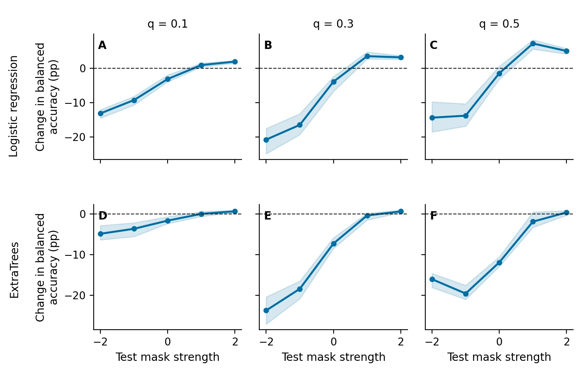
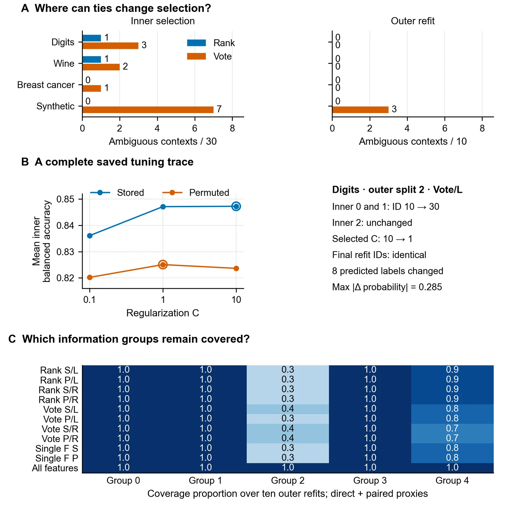
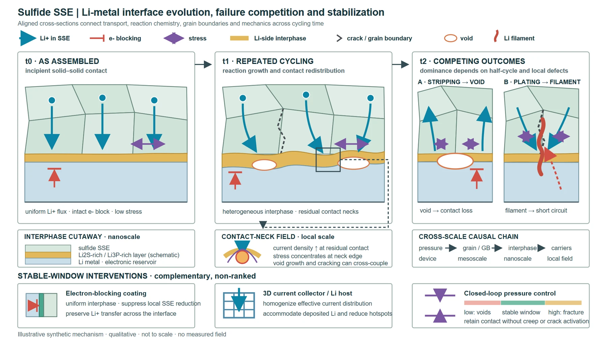
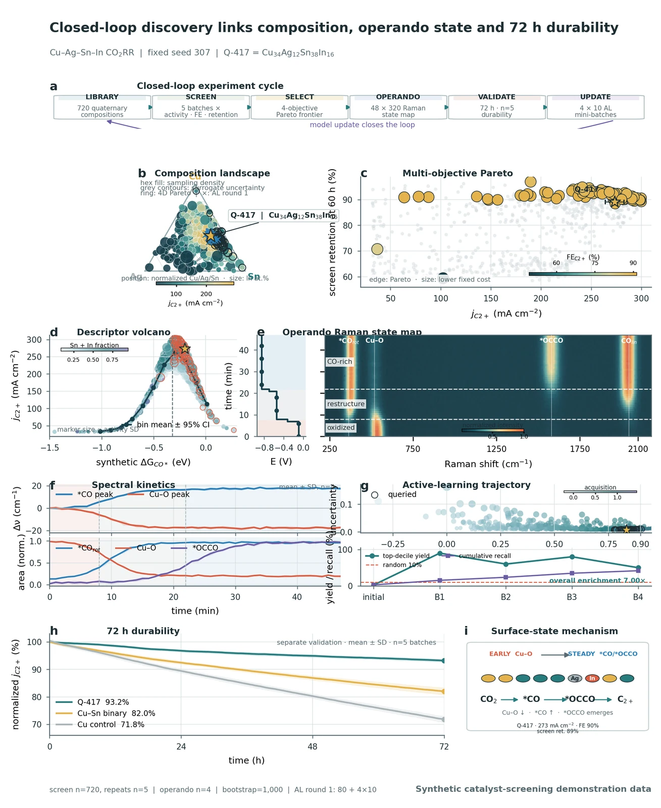

[English](README.md) · **简体中文**

<p align="center"><a href="https://wubing2023.github.io/PaperSpine/v6/zh/"></a></p>

**PaperSpine 是开源的 AI for Science 科研工作流。** 用你的科研 Agent 读文献、设计和执行分析、绘制科研图，并交付有证据支撑的可编辑论文。

[**官网**](https://wubing2023.github.io/PaperSpine/v6/zh/) · [科研案例](#research-cases) · [安装](#installation) · [**媒体素材包**](#press-kit)

<a id="research-cases"></a>

## 科研案例

这里展示 PaperSpine 参与的实际研究和作者产物。研究方法、结果与适用范围都可以打开原图和研究稿核对。

### Dry Bean · 缺失机制压力测试

Agent 使用公开的豆类形态测量数据设计压力测试，比较两个分类器在缺失机制一致和反转时的表现。

去重后分析 13,543 条记录，得到 2,160 个评估单元。人工缺失率为 30% 时，逻辑回归增加缺失指示变量，在机制一致时使平衡准确率提高 **3.14 个百分点**，在机制反转时下降 **20.75 个百分点**。结果适用于这一受控压力测试。

<a href="paperspine5/core/07_发布页/v6/science/dry-bean-figure.svg"></a>

[阅读研究稿](paperspine5/core/07_发布页/v6/science/dry-bean-paper.pdf) · [打开原始矢量图](paperspine5/core/07_发布页/v6/science/dry-bean-figure.svg) · [数据来源](https://doi.org/10.24432/C50S4B)

### Bootstrap 特征聚合 · 稳定性诊断

从实际调参记录追查一个小细节：并列特征的取舍会影响模型，即使最终选中的特征完全一样。

在 Digits 的一次划分中，调参从 **C = 10 变成 C = 1**，有 **八个样本预测标签变化**。稿件同时记录三个公开数据集和一个合成条件的实现诊断。

<a href="paperspine5/core/07_发布页/v6/science/feature-aggregation-figure.svg"></a>

[阅读研究稿](paperspine5/core/07_发布页/v6/science/feature-aggregation-paper.pdf) · [打开原始矢量图](paperspine5/core/07_发布页/v6/science/feature-aggregation-figure.svg) · [案例证据与出处](paperspine5/core/07_发布页/v6/science/case-notes.md)

### 不同学科的可编辑制图

图件库里有 **固态电池界面机理图** 和 **闭环催化剂筛选图**，分别展示机理示意和模拟数据的多面板表达。

<p><a href="https://wubing2023.github.io/PaperSpine/v6/zh/#figures"></a></p>

[到 Figure Studies 下载原尺寸 PNG 和 SVG](https://wubing2023.github.io/PaperSpine/v5/figure-studies/)

<a id="ways-to-work"></a>

## 三种使用方式

### 全流程 Skill

把研究问题、结果目录或初稿交给宿主，调用 $paper-spine，再确认需要推进的研究或写作范围。

- **怎么开始** · `$paper-spine`
- **能得到什么** · 按范围交付文献和证据记录、分析、科研图和可编辑稿件。
- **环境** · 支持 Skill 的宿主

[下载 全流程 Skill ↓](https://github.com/WUBING2023/PaperSpine/releases/download/v6.0.0-beta.2/paperspine-skill-6.0.0-beta.2.zip)

### Skills 包

安装全流程入口和五个独立阶段 Skill。只想修一段、重画一幅图或审阅现稿时，可以从现有结果开始。

- **怎么开始** · `$paper-spine-followwriting`
- **能得到什么** · 引用对照的改稿、可编辑图件、审阅意见或论文交付包。
- **环境** · 支持 Skill 的宿主

[下载 Skills 包 ↓](https://github.com/WUBING2023/PaperSpine/releases/download/v6.0.0-beta.2/paperspine-skills-pack-6.0.0-beta.2.zip)

### Web 插件包

从宿主打开论文任务，在工作台保存设置、比较图件、预览文件并提交返修意见。

- **怎么开始** · `$paper-spine-web:paper-spine-web`
- **能得到什么** · 保存选择、反馈和预览，下载同一论文任务的文件。
- **环境** · Windows x64 · Codex

[下载 Web 插件包 ↓](https://github.com/WUBING2023/PaperSpine/releases/download/v6.0.0-beta.2/paperspine-web-plugin-6.0.0-beta.2-windows-x64.zip)

**Skills 包可单独调用的五个环节**

- `$paper-spine-study` · 研究问题和实验设计
- `$paper-spine-followwriting` · 参考真实论文改写
- `$paper-spine-figures` · 科研图件与可编辑图源
- `$paper-spine-review` · 论文、引文和证据审阅
- `$paper-spine-deliver` · 稿件与文件交付

<a id="installation"></a>

## 安装与版本管理

任选一个 ZIP 并下载校验清单。解压 ZIP，在解压目录运行管理器，传入原 ZIP 路径和对应 SHA-256。安装好后打开一个新对话。

```text
python -B edition_manager.py install "<原 ZIP 路径>" --sha256 <SHA256>
```

管理器需要 Python 3.12 或以上。Web 包自带 Windows Python，还需要 Codex CLI。使用其他宿主时按指南选择 Skill 目录，也可手动放置。

受管安装可检查和应用更新、关闭自动检查、回退或卸载，保留稿件及本地任务。V5 继续走独立频道。旧 profile 可以在 V5 打开，也可以将现有论文文件带到 V6 接续。

[完整安装、更新与卸载说明](INSTALL-V6.md) · [发行资产](https://github.com/WUBING2023/PaperSpine/releases/tag/v6.0.0-beta.2) · [校验文件](https://github.com/WUBING2023/PaperSpine/releases/download/v6.0.0-beta.2/checksums.sha256)

<a id="paper-example"></a>
<a id="feature-demos"></a>

## 功能短片

三段短片展示功能。Followwriting 是流程演示，放大科研图和稿件预览取自加载该案例的正式 Windows 插件。

### Followwriting

参考原论文的结构和论证，改写时以自己的证据落笔。

<picture>
  <source media="(prefers-reduced-motion: reduce)" srcset="paperspine5/core/07_发布页/v6/science/followwriting-hd-still.webp">
  
</picture>

### 科研图预览

在本地工作台打开研究图件，查看原尺寸内容。

<picture>
  <source media="(prefers-reduced-motion: reduce)" srcset="paperspine5/core/07_发布页/v6/science/figures-hd-still.webp">
  
</picture>

### 论文预览

在工作台打开同一研究的论文阅读稿。

<picture>
  <source media="(prefers-reduced-motion: reduce)" srcset="paperspine5/core/07_发布页/v6/science/workbench-hd-still.webp">
  
</picture>

<a id="press-kit"></a>

## 媒体与创作者素材

可直接引用的介绍、方便裁切的图和三段功能短片。整包附折纸龙 Spine 透明底、1920×1080 横版与 1080×1350 竖版封面、原尺寸截图、科研图和出处说明。

> PaperSpine 是一个开源的 AI for Science 研究工作流。它把文献、分析、科研图与可编辑论文放在同一个研究项目里。研究者可以用一个 Skill 跑全流程，按需要单独调用写作、制图或审阅阶段，也可以在 Codex 的本地工作台审查同一篇论文。

[**下载完整媒体包 ↓**](https://wubing2023.github.io/PaperSpine/v6/science/paperspine-v6-press-kit.zip) · [双语文案与图注](paperspine5/core/07_发布页/v6/science/press-copy.md) · [案例证据与出处](paperspine5/core/07_发布页/v6/science/case-notes.md) · [原尺寸工作台 PNG](paperspine5/core/07_发布页/v6/science/workbench-figures.png)

<a href="https://wubing2023.github.io/PaperSpine/v6/science/spine.png"></a>

## 开发与社区

[V6 源码](paperspine5/core/01_PaperSpine4/src/skill-editions/) · [安装管理器](paperspine5/core/06_插件化/release/edition_manager.py) · [官网源码](paperspine5/core/07_发布页/v6/) · [问题反馈](https://github.com/WUBING2023/PaperSpine/issues)

<details>
<summary>V5 文档与源码索引</summary>

- 方法与工作件 · [writing_rationale_matrix](src/skill/references/rewrite.md) · [citation_support_bank](src/skill/references/citation-support-bank.md) · [translation_package](src/skill/references/translation-package.md)
- 导出及验证工具 · [artifact_check.py](src/scripts/artifact_check.py) · [reference_inventory.py](src/scripts/reference_inventory.py) · [citation_bank_check.py](src/scripts/citation_bank_check.py) · [latex_guard.py](src/scripts/latex_guard.py) · [word_guard.py](src/scripts/word_guard.py)
- 旧版宿主投影 · [Codex](dist/codex/skills/paper-spine/) · [Claude](dist/claude/skills/paper-spine/) · [OpenClaw](dist/openclaw/skills/paper-spine/) · [Claude command](dist/claude/commands/paperspine.md)
- V5 安装器 · [install.ps1](install.ps1) · [install.sh](install.sh)

[V5 存档](https://wubing2023.github.io/PaperSpine/v5/?legacy=1) · [日本語](README.ja.md) · [한국어](README.ko.md) · [Español](README.es.md) · [Français](README.fr.md) · [Deutsch](README.de.md) · [Русский](README.ru.md) · [Português](README.pt.md)

</details>

## 许可证

[MIT](LICENSE) · [Instrument Serif](paperspine5/core/07_发布页/v6/fonts/instrument-OFL.txt) · [Noto Serif SC](paperspine5/core/07_发布页/v6/fonts/notoserifsc-OFL.txt)
